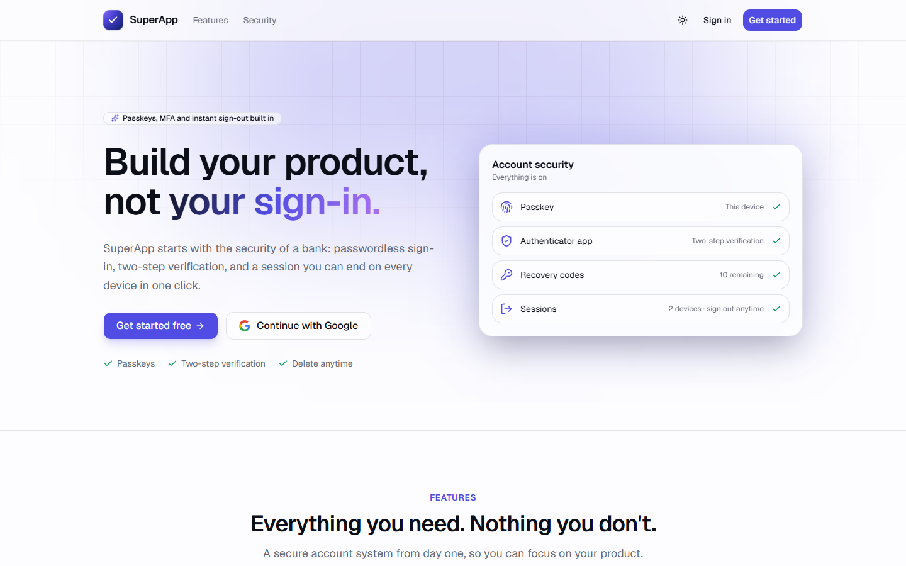
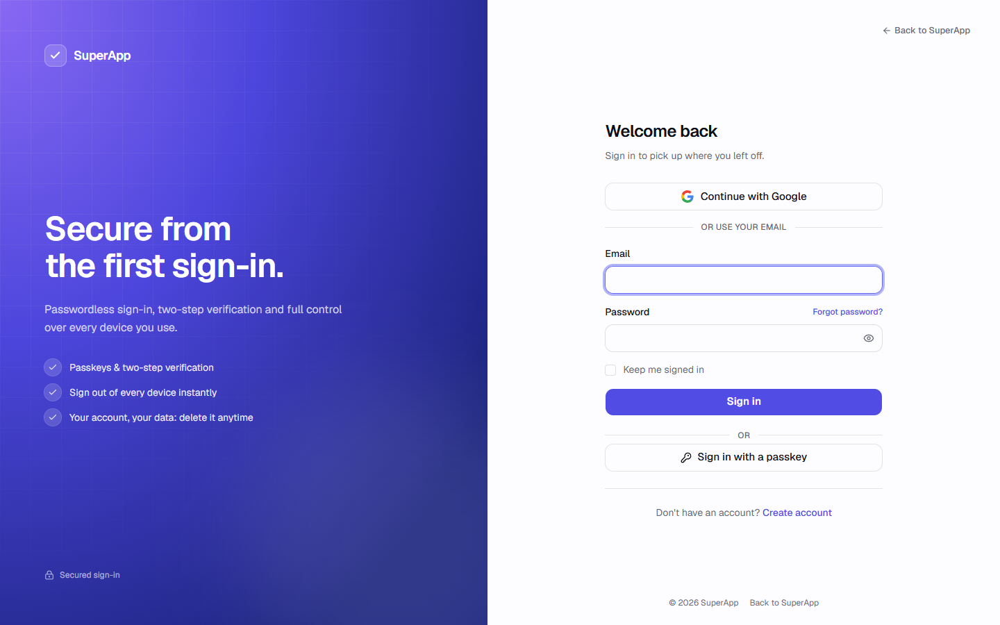
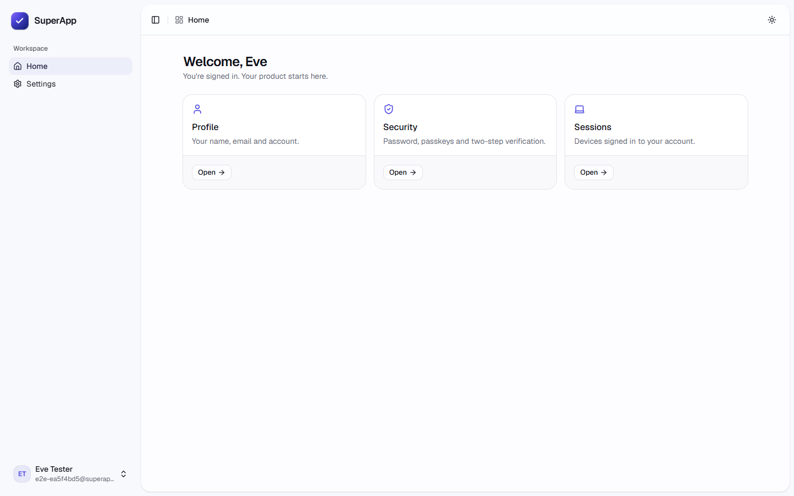
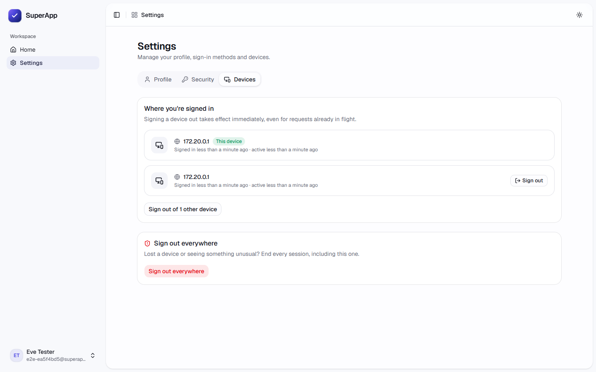
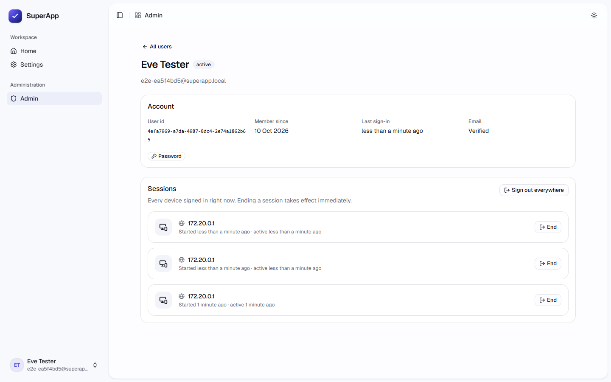
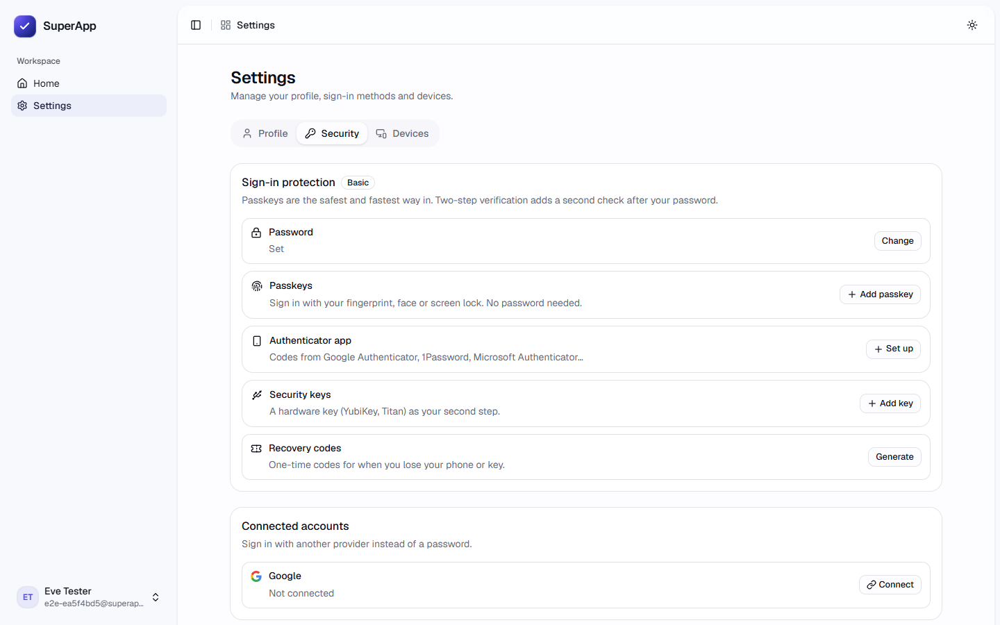
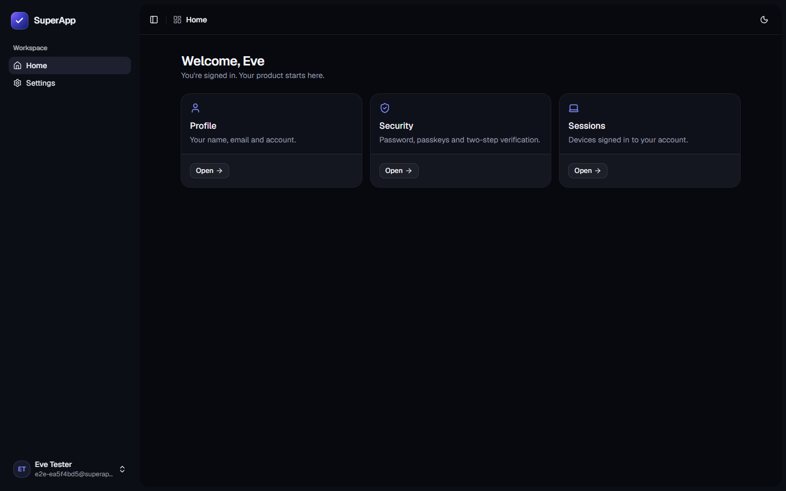
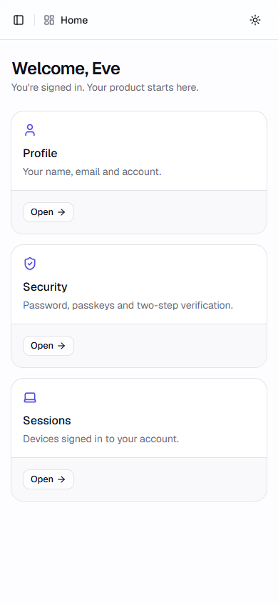
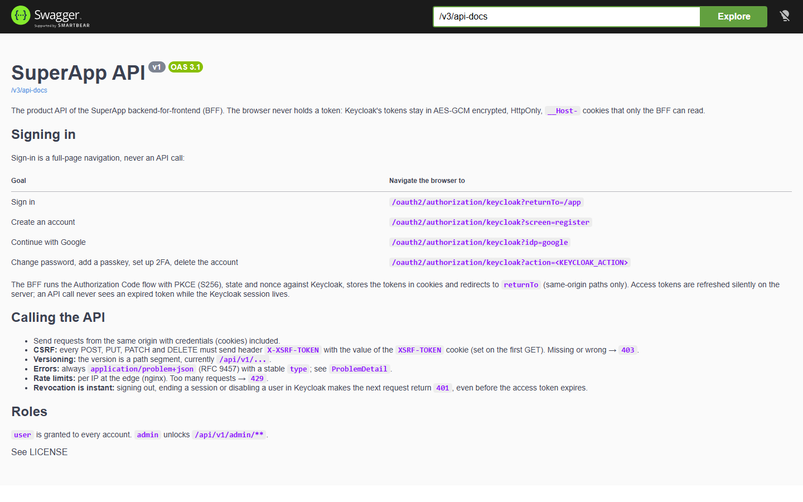
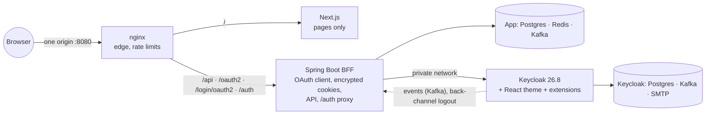

# SuperApp

**A production-shaped starter for products that need serious sign-in from day one.**
Spring Boot 4.1 BFF · Keycloak 26.8 · Next.js 16 · everything in Docker · the browser never holds a token.




<!-- template:start -->
## Use this template

Create your own product from it in one command. Every spelling of the name is renamed: Java packages, realm, themes,
Docker images, database, environment variables, UI texts and emails.

```bash
# from a local checkout into a new folder (the template stays untouched)
node scripts/init-project.mjs "Acme Shop" ../acme-shop --fresh-git

# or straight from GitHub, nothing to clone (--env reuses your template .env: Google client, SMTP)
npx github:Jaga1999/SuperAppTemplate "Acme Shop" --env ./SuperApp/.env --fresh-git
```

Step-by-step runbook (generate, check, test, verify): [docs/project-initialization.md](docs/project-initialization.md).
Every option and what gets renamed: [docs/template.md](docs/template.md).
<!-- template:end -->

## What you get

| | |
|---|---|
| **Sign-in done properly** | Email + password, passkeys, authenticator app (TOTP), recovery codes, Google, email verification, password reset, versioned Terms and Privacy consent, brute-force protection |
| **No tokens in the browser** | Backend-for-frontend: OAuth 2 Authorization Code + PKCE on the server, tokens in AES-256-GCM encrypted `HttpOnly` `__Host-` cookies, silent refresh, CSRF protection |
| **Instant sign-out** | End one device or every device; revocation is enforced on the next request through Redis, and Keycloak's back-channel logout reaches the BFF |
| **Keycloak, hidden and themed** | Keycloak runs only behind the BFF's allow-listed `/auth` proxy; its pages are a React theme (Keycloakify) that matches the app |
| **Ready-made screens** | Landing page, sign-in and sign-up, home, profile, security (password, passkeys, MFA, Google), devices, admin overview, users, per-user sessions |
| **Users synced to the app** | Keycloak events flow through Kafka into the app's own `app_user` table, with a nightly reconciliation |
| **Production habits** | Separate Postgres and Kafka for the app and for Keycloak, Flyway, health checks, Prometheus metrics, JSON logs, hardened containers, rate limits, strict CSP |
| **Tested for real** | Unit, architecture (ArchUnit), integration (Testcontainers) and end-to-end tests that register a fresh account through the real stack |
| **Every part deployable on its own** | Edge, frontend, backend and identity build from their own folders and meet only through configuration |

| Sign in | Home | Devices | Admin: one user |
|---|---|---|---|
|  |  |  |  |

| Security settings | Dark mode | Phone | API docs |
|---|---|---|---|
|  |  |  |  |

## Quick start

Needs **Docker** (6 GB memory for Docker Desktop) and **Node.js 22+**.

```bash
git clone https://github.com/<owner>/<repo>.git superapp
cd superapp
node scripts/start.mjs
```

The first run creates `.env` with generated secrets, builds the images and waits until all ten containers are healthy
(5–10 minutes the first time, about a minute afterwards). Then open:

| What | Where |
|---|---|
| The app | <http://localhost:8080> |
| Emails (verification, reset) | <http://localhost:8025> (Mailpit) |
| API docs | <http://localhost:8081/swagger-ui.html> |
| Keycloak admin console | <http://localhost:8180/auth> |

Seed users: `admin@superapp.local` (role admin) and `user@superapp.local`; their passwords are `SEED_ADMIN_PASSWORD` and
`SEED_USER_PASSWORD` in `.env`. Or click *Get started* and register your own account.

Step by step, with screenshots: [docs/getting-started.md](docs/getting-started.md).

## How it fits together



- The **browser** talks only to nginx, on one origin. It holds encrypted cookies, never a token.
- The **Next.js server** renders pages and talks to nobody.
- The **BFF** is the OAuth client, keeps tokens in encrypted cookies, refreshes them silently, serves the API and
  proxies only the Keycloak paths the sign-in pages need.
- **Keycloak** owns identities, credentials and sessions. No HTTP sessions or Spring Session in the app.

Full walkthrough with sequence diagrams: [docs/architecture.md](docs/architecture.md).

## Tech stack

| Area | Stack |
|---|---|
| Backend | Java 25, Spring Boot 4.1, Spring Security (OAuth2 client + resource server), Spring Cloud Gateway MVC, Spring Data JPA, Flyway, Spring Kafka, Redis, springdoc-openapi 3, Gradle (Kotlin DSL), JUnit 5, Testcontainers, ArchUnit |
| Identity | Keycloak 26.8 on Java 25, Keycloakify 11 (React theme), custom Java extensions (Kafka event listener, legal consent) |
| Frontend | Next.js 16 (App Router), React 19, TypeScript 7, Tailwind CSS 4, shadcn/ui, TanStack Query 5, Zustand 5, Biome, Playwright |
| Infrastructure | Docker Compose, nginx, PostgreSQL 18 ×2, Redis 8, Apache Kafka 4 (KRaft) ×2, Mailpit |

npm only (no pnpm or yarn); Biome for linting and formatting.

## Repository layout

```text
backend/       Spring Boot BFF                       → its own image
frontend/      Next.js app + Playwright e2e          → its own image
keycloakify/   Keycloak sign-in theme (React)        ┐
keycloak/      realm, emails, extensions, legal      ┘ → the Keycloak image
infra/         nginx edge, Postgres init             → nginx image
scripts/       start.mjs: run the whole stack locally with one command
docs/          documentation and screenshots
```

Every folder and file explained: [docs/project-structure.md](docs/project-structure.md).

## Everyday commands

| Task | Command |
|---|---|
| Start / rebuild everything | `node scripts/start.mjs` |
| Status · logs | `node scripts/start.mjs status` · `node scripts/start.mjs logs backend` |
| Stop (keep data) · wipe data | `node scripts/start.mjs stop` · `node scripts/start.mjs reset --yes` |
| Rebuild one service | `docker compose up -d --build --wait backend` (or `frontend`, `keycloak`, `nginx`) |
| App with hot reload | `npm --prefix frontend run dev` → <http://localhost:5173> |
| Sign-in pages with mock data | `npm --prefix keycloakify run dev` → <http://localhost:5174/?kc=login.ftl> |
| Backend tests (Docker running) | `cd backend && ./gradlew test` |
| Type check · lint | `npm run typecheck` · `npm run lint` in `frontend/` or `keycloakify/` |
| End-to-end tests | `npm --prefix frontend run e2e` |

## Documentation

| Start here | |
|---|---|
| [Getting started](docs/getting-started.md) | Install, run, try every feature |
| [Local development](docs/development.md) | Daily workflow, hot reload, what to rebuild, recipes |
| [Project structure](docs/project-structure.md) | Every folder and file; *where do I change…?* |
| [Customization](docs/customization.md) | Name, colors, logo, texts, roles, password rules, social logins |
| [Troubleshooting](docs/troubleshooting.md) | Symptoms and fixes |

| How it works | |
|---|---|
| [Architecture](docs/architecture.md) | Big picture, sign-in, API calls, sign-out and revocation, user sync |
| [Security](docs/security.md) | Threat model, why encrypted cookies and no server sessions, every layer |
| [Backend](docs/backend.md) | Request flow, packages, API, data, Kafka, configuration |
| [Frontend](docs/frontend.md) | Pages, data flow, state, SEO, styling |
| [Keycloak](docs/keycloak.md) | Concepts, how it connects to the app, the Keycloakify pipeline, theme, realm, extensions, emails |

| Operate it | |
|---|---|
| [Configuration](docs/configuration.md) | Every `.env` variable and setting |
| [Docker](docs/docker.md) | Services, networks, volumes, images, tuning, inspecting |
| [Scripts](docs/scripts.md) | `start.mjs` (local run) and the project generator |
| [Testing](docs/testing.md) | Levels and the full scenario list · [backend](docs/testing-backend.md) · [frontend](docs/testing-frontend.md) |
| [Deployment](docs/deployment.md) | What to know before production, topologies, checklist |
| [Decoupled projects](docs/decoupled.md) | Deploying each part separately, the contracts between them |
| [Project initialization](docs/project-initialization.md) | Runbook: generate a project, `.env`, Google, tests, verification |
| [Using the template](docs/template.md) | Generator options and what gets renamed |

## Security at a glance

- Authorization Code + PKCE (S256), confidential client, exact redirect URIs, refresh-token rotation with no reuse.
- Tokens only in AES-256-GCM encrypted, `HttpOnly`, `Secure`, `SameSite=Lax`, `__Host-` cookies; CSRF token on every
  mutation; JWTs verified locally (signature, issuer, audience, `azp`, type, expiry, revocation).
- Keycloak reachable only through the BFF's path allow-list; its admin API is never proxied.
- Strict per-request CSP nonce, security headers, per-IP rate limits, non-root read-only containers with no
  capabilities, private networks per data store.

Details and how to verify each one: [docs/security.md](docs/security.md). Found a vulnerability? Please report it
privately to the maintainer rather than in a public issue.

## Contributing

Read [AGENTS.md](AGENTS.md) (also the guide for AI coding agents): conventions, commands and the definition of done.
In short: latest stable versions pinned exactly, no deprecated APIs, zero warnings, tests and docs updated with every
change.

## License

[MIT](LICENSE)
