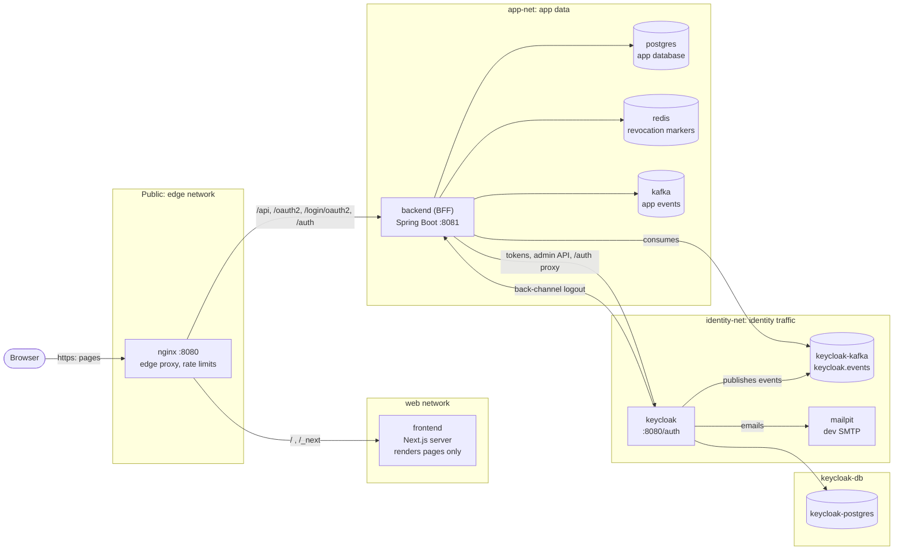
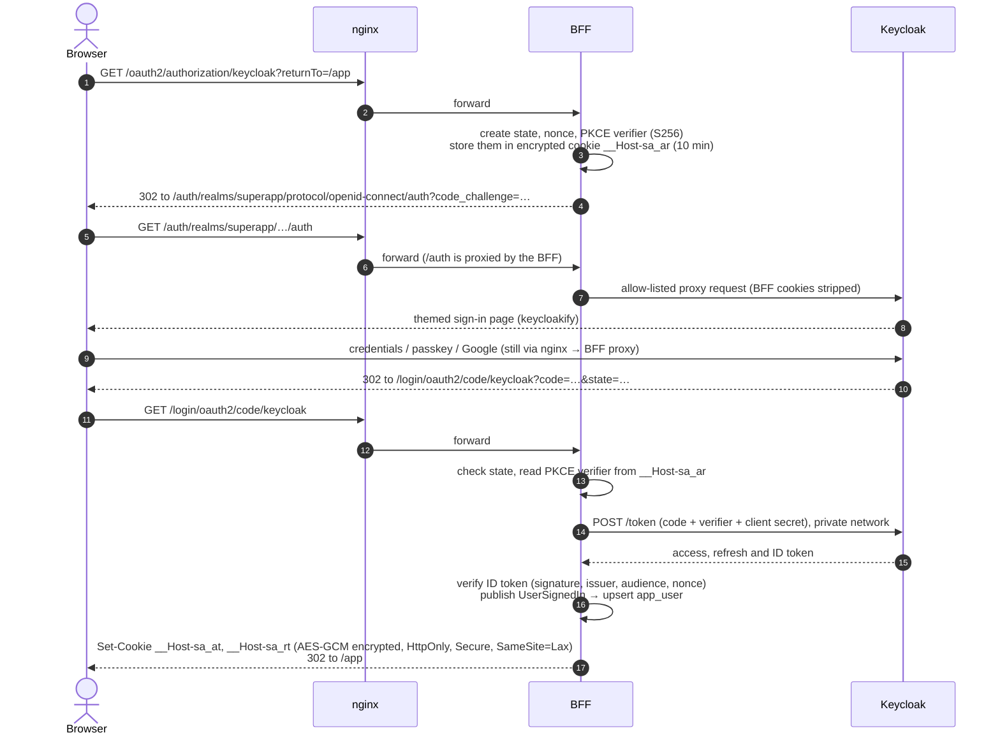
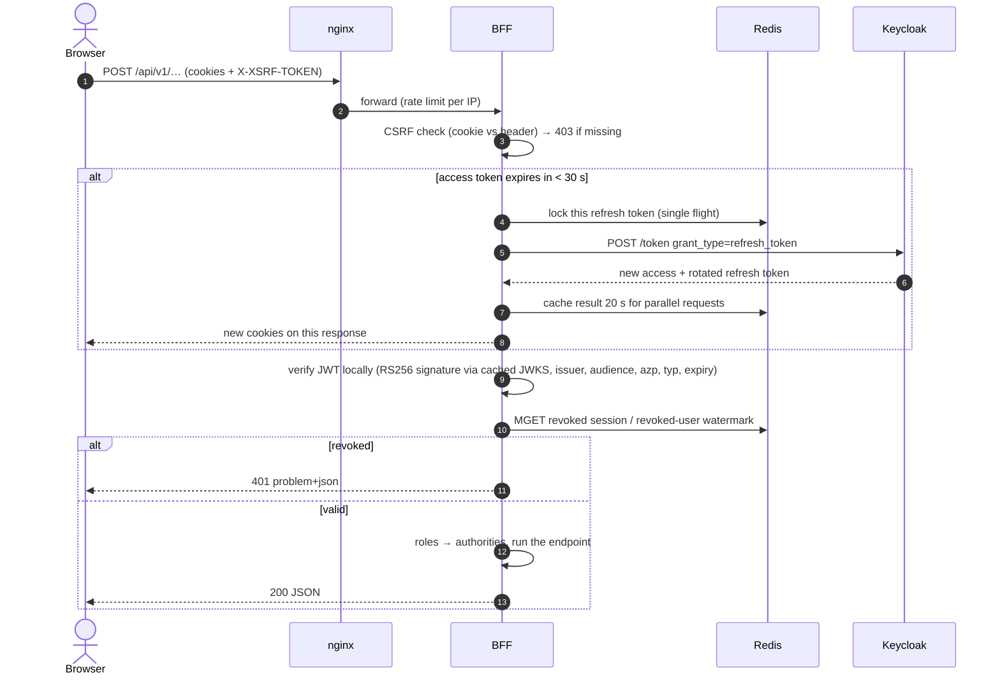
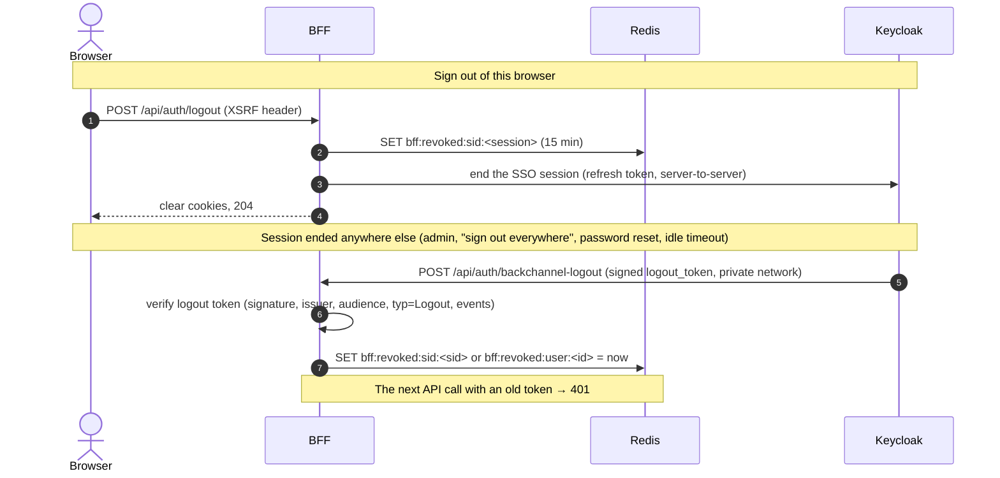
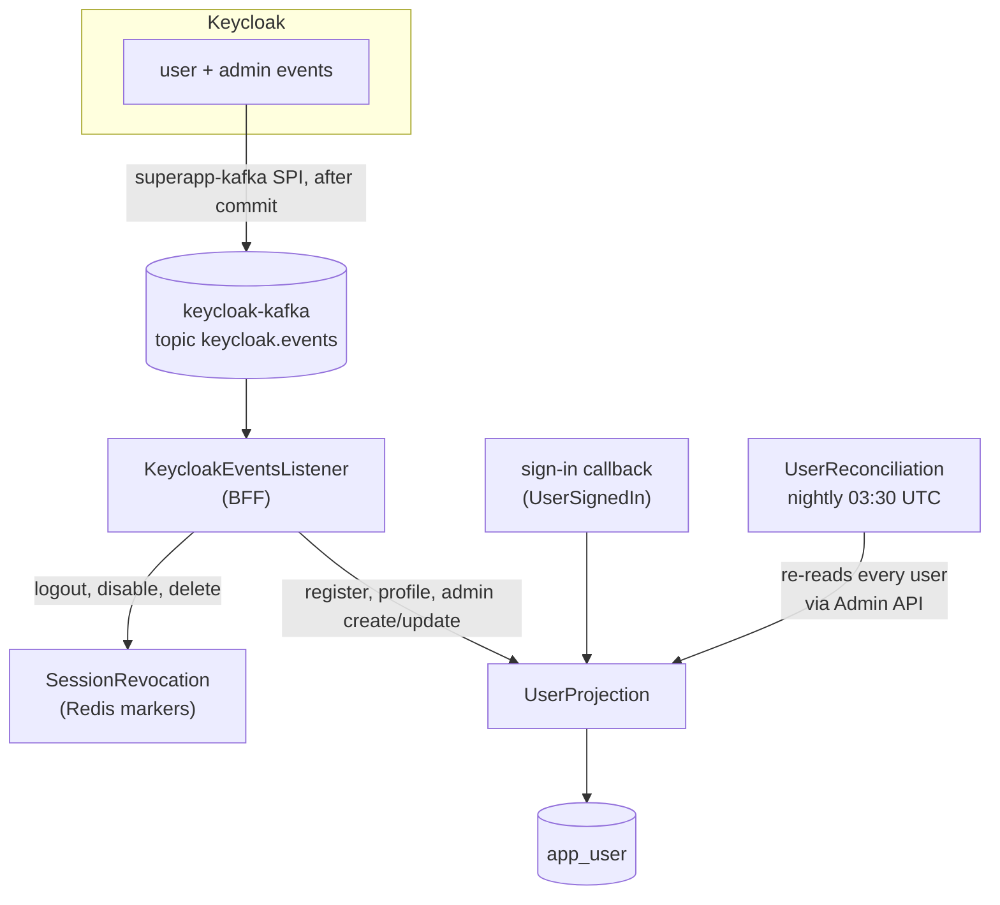
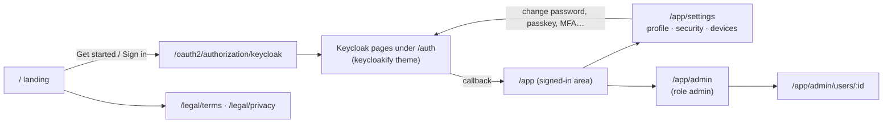

# Architecture

How the pieces fit, how every request travels, and why it is built this way. Diagrams render on GitHub (Mermaid).

## 1. The big picture

One public entry point (nginx). Behind it, a **backend-for-frontend (BFF)** that is the only component allowed to talk
to Keycloak. The browser never holds a token and never talks to Keycloak directly.



Rules the network layout enforces (verified with connection tests):

| From | Can reach | Cannot reach |
|---|---|---|
| Browser | nginx only (port 8080) | everything else |
| nginx | frontend, backend | Keycloak, databases, Kafka, Redis |
| frontend (Next.js) | nothing (it only answers nginx) | backend, Keycloak, any data store |
| backend | its Postgres, Redis, Kafka; Keycloak; Keycloak's Kafka | Keycloak's database |
| keycloak | its Postgres and Kafka, Mailpit, the backend (back-channel logout) | frontend, the app's database |

The app and Keycloak each have their **own** Postgres and Kafka, so a migration, an outage or load on one side can't
touch the other. Keycloak has no Redis: it caches in its embedded Infinispan.

## 2. Who does what

| Component | Responsibility | Never does |
|---|---|---|
| **Keycloak** | All authentication: sign-up, sign-in, passwords, passkeys, MFA, recovery codes, Google, email verification, password reset, sessions, tokens, user and role storage | Serve the browser directly; it is private |
| **keycloakify** | The sign-in pages Keycloak renders (React, built into a theme JAR) | Run on its own in production |
| **backend (BFF)** | OAuth client for the browser, token storage in encrypted cookies, silent refresh, CSRF, the allow-listed `/auth` proxy, instant revocation, the product API, the user projection | Store sessions (no HTTP session, no Spring Session); show login forms; accept passwords |
| **frontend** | Renders the landing page, legal pages and the signed-in app; sets a strict per-request CSP | Call the BFF or Keycloak from the server; touch tokens |
| **nginx** | The only public port; routes paths; per-IP rate limits; blocks internal endpoints | Talk to Keycloak |

## 3. Signing in (Authorization Code + PKCE through the BFF)



Why it's safe:

- **PKCE (S256) + state + nonce**: a stolen authorization code is useless; the login can't be forged or replayed.
- **Confidential client**: the code exchange needs the client secret, which only the BFF has.
- **Exact redirect URIs** in the realm; the `returnTo` path is allow-listed (same-origin paths only, no `//host`).
- The browser only ever sees encrypted cookies it can't read (HttpOnly).

## 4. Every API call



- **Silent refresh** happens on the server; the frontend never notices. Refresh tokens rotate with **zero reuse**, so
  parallel requests must not refresh twice: the Redis lock makes the first request refresh and the others reuse its
  result.
- **CSRF**: cookies are sent automatically, so every write must carry `X-XSRF-TOKEN` copied from the `XSRF-TOKEN`
  cookie (Spring's double-submit). The bearer token is only read from the cookie *after* the CSRF check passed, so a
  cookie-authenticated write without the header gets 403.
- **Local JWT verification**: no call to Keycloak per request; the public keys are fetched once on the private network.

## 5. Signing out, and instant revocation

There are **no sessions in the BFF**. Keycloak owns sessions. The BFF only makes sure that, once Keycloak ends a
session, tokens issued for it stop working immediately instead of living out their 5 minutes.



Revocation also arrives through Keycloak's event stream (Kafka): user disabled, deleted, logged out by an admin. A
marker lives 15 minutes (longer than any access token), then expires on its own. Redis holds **only** these markers and
a few seconds of refresh de-duplication; no session data.

## 6. Keeping the app's user table in sync

Keycloak owns identity. The app keeps a small projection (`app_user`) for joins, admin lists and erasure.



| Path | When | What |
|---|---|---|
| Sign-in | every sign-in | Upsert from the verified ID token (never resurrects an erased user) |
| Events | seconds after a change in Keycloak | Registration, profile and email changes, admin create/update/disable/delete |
| Reconciliation | nightly (`superapp.user.reconciliation.cron`) | Re-reads every local user from Keycloak and repairs drift; erases users Keycloak no longer has. One run per cluster (Redis lock); aborts if the realm doesn't answer; stops after 50 erasures |

The reconciliation exists because Keycloak's event producer is fire-and-forget: a sign-in never waits for Kafka, so an
event can be lost during a broker outage.

## 7. The pages



Account changes (password, passkeys, authenticator app, recovery codes, linking Google, deleting the account) are not
API calls: the app navigates to `/oauth2/authorization/keycloak?action=<ACTION>`, Keycloak shows its themed page,
and the user returns with `?action=success|cancelled|error`.

## 8. Backend modules

```text
com.superapp
├── shared      error model (RFC 9457), request id, crypto (AES-GCM), Jackson policy, Kafka topics, OpenAPI, API versioning
├── auth        security chains, OAuth client, encrypted cookies, refresh, revocation, the /auth proxy
├── identity    Keycloak Admin API client, Keycloak event consumer, account endpoints, public config
├── user        local user projection (app_user), /me, nightly reconciliation
└── admin       admin overview, users, sessions (role admin)
```

A feature's root package is its public API; implementation lives in `<feature>.internal`. `ArchitectureTest`
(ArchUnit) fails the build if a feature reaches into another's `internal` package, if `shared` depends on a feature, or
if packages form a cycle. Details: [backend.md](backend.md).

## 9. Why these choices

| Choice | Reason |
|---|---|
| BFF instead of tokens in the browser | No token can be stolen by XSS; the IETF's recommendation for browser apps |
| Keycloak private, proxied by the BFF | One origin for cookies; the only reachable Keycloak paths are an allow-list |
| Encrypted cookies, no server sessions | Stateless BFF: any instance serves any request; nothing to replicate |
| Local JWT checks + Redis revocation markers | Fast requests without asking Keycloak, yet sign-out takes effect immediately |
| Separate data stores for app and Keycloak | Failure and security isolation; each side can be scaled or moved alone |
| Next.js server (not a static export) | Per-request CSP nonce: no inline script runs unless the server rendered it |
| Feature packages + ArchUnit | Modular monolith without a framework; boundaries are tested |
