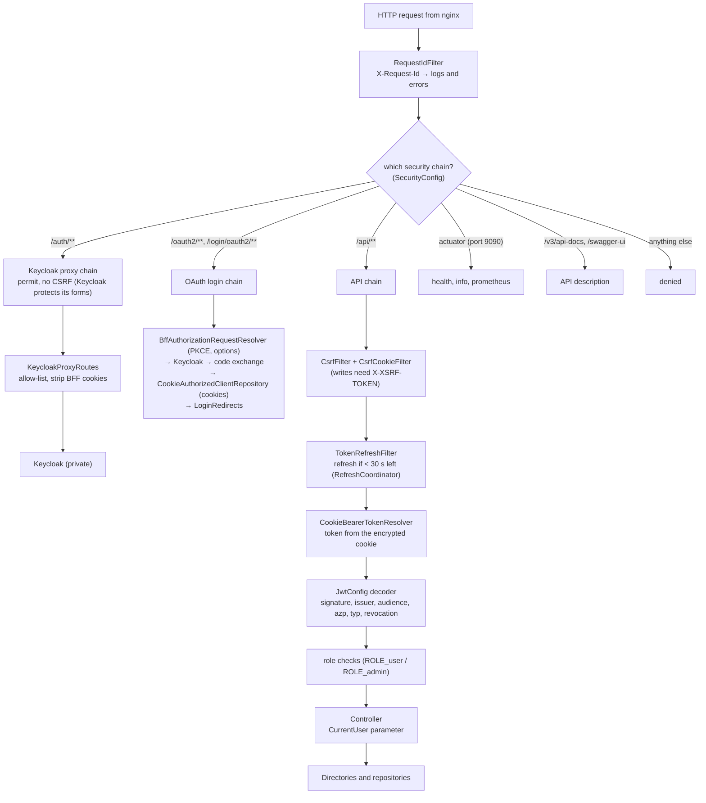

# Backend (the BFF)

Spring Boot 4.1 on Java 25, built with Gradle (Kotlin DSL), one module, packaged by feature. It is a
**backend-for-frontend**: the browser's only server-side partner. It never shows a login form and never stores
sessions; Keycloak does both.

## 1. What the backend does

1. **Runs the sign-in handshake** with Keycloak for the browser (Authorization Code + PKCE) and keeps the resulting
   tokens in encrypted cookies.
2. **Proxies Keycloak's sign-in pages** under `/auth` through an allow-list, so Keycloak itself stays private.
3. **Protects every API call**: CSRF, silent token refresh, local JWT verification, instant revocation.
4. **Serves the product API** (`/api/v1/...`): who am I, account security and devices, admin.
5. **Keeps a local copy of users** (`app_user`) in sync with Keycloak.

## 2. A request's journey through the backend



Errors anywhere become RFC 9457 problem details (`application/problem+json`) with a stable `type`, the request id and
no stack trace (`GlobalExceptionHandler`, `ProblemSecurityHandlers`).

## 3. Packages and files

```text
com.superapp
├── SuperAppApplication.java         entry point; UTC; @EnableScheduling, @EnableResilientMethods
├── shared/                          used by every feature; depends on none
│   ├── config/JacksonConfig         one JSON policy for HTTP, Kafka, Redis, cookies (strict, duplicate keys rejected, size limits)
│   ├── config/KafkaTopicsConfig     topics on the app's Kafka (+ .DLT dead-letter topics), created at startup
│   ├── config/OpenApiConfig         API description: info, cookie + CSRF schemes, shared error responses, /api/v1 paths
│   ├── config/WebConfig             API versioning (/api/v1), page JSON format, argument resolvers
│   ├── crypto/AeadCipher            AES-256-GCM with a key per purpose (HKDF-SHA256)
│   └── web/                         DomainException, GlobalExceptionHandler, Problems, RequestContext, RequestIdFilter
├── auth/                            security (public: BffProperties, CurrentUser, SessionRevocation, UserSignedIn)
│   └── internal/
│       ├── SecurityConfig           the ordered filter chains
│       ├── cookie/AuthCookies       the three encrypted __Host- cookies
│       ├── gateway/KeycloakProxyRoutes   the /auth allow-list proxy (Spring Cloud Gateway MVC)
│       ├── oauth/                   login: request resolver (PKCE), LoginOptions allow-list, cookie repositories,
│       │                            LoginRedirects (success/failure), OAuthClientConfig (client registrations)
│       ├── token/                   JwtConfig, JwtPeek, KeycloakTokenClient (refresh, logout), RefreshCoordinator,
│       │                            TokenRefreshFilter, CookieBearerTokenResolver, LogoutTokenVerifier,
│       │                            RedisSessionRevocation, TokenSet
│       └── web/                     AuthController (logout, back-channel logout), CsrfCookieFilter,
│                                    CurrentUserArgumentResolver, ProblemSecurityHandlers, docs/AuthApiDocs
├── identity/                        Keycloak as a directory (public: IdentityDirectory, IdentityEvent)
│   └── internal/
│       ├── KeycloakAdminApi         declarative HTTP client (@HttpExchange) for the Admin REST API
│       ├── KeycloakIdentityDirectory  users, sessions, credentials, linked providers (retries on network errors)
│       ├── IdentityConfig           admin client with the service-account token; Kafka error handling (retries → DLT)
│       ├── KeycloakEventsKafkaConfig  consumer for Keycloak's own Kafka
│       ├── KeycloakEventsListener   events → revocation markers + IdentityEvents
│       ├── IdentityEventMessage     the event wire format
│       ├── AccountController        /api/v1/account: devices, security overview, unlink provider
│       ├── PublicConfigController   /api/v1/public/config (Google button flag)
│       └── IdentityProperties, docs/
├── user/                            the local projection (public: UserDirectory)
│   └── internal/
│       ├── AppUser, AppUserRepository   entity + race-free upsert, keyset paging
│       ├── UserProjection           applies sign-ins and Keycloak events to app_user
│       ├── UserReconciliation       nightly repair job
│       ├── JpaUserDirectory         read API for other features
│       └── MeController, docs/      /api/v1/me
└── admin/
    └── internal/AdminController, docs/   /api/v1/admin: overview, users, user detail, end a session, sign out everywhere
```

A feature's root package is its public API; everything else lives in `internal`. `ArchitectureTest` enforces it.

## 4. The API

| Method and path | Who | What |
|---|---|---|
| `GET /api/v1/public/config` | anyone | Feature flags for the landing page (`googleLoginEnabled`) |
| `GET /api/v1/me` | signed in | The current user; 401 means "not signed in" |
| `GET /api/v1/account/sessions` | signed in | My devices (`current` marks this browser) |
| `DELETE /api/v1/account/sessions/{id}` | signed in | Sign out one of my devices |
| `POST /api/v1/account/sessions/sign-out-others` | signed in | Sign out all my other devices |
| `POST /api/v1/account/sessions/sign-out-all` | signed in | Sign out everywhere |
| `GET /api/v1/account/security` | signed in | Password, authenticator, passkeys, recovery codes, linked providers |
| `DELETE /api/v1/account/linked-providers/{alias}` | signed in | Unlink Google (refused if it's the only way to sign in) |
| `GET /api/v1/admin/overview` | admin | Active users, users in Keycloak, sign-ups in 7 days |
| `GET /api/v1/admin/users?page=&size=` | admin | Users, newest first (size 1–100) |
| `GET /api/v1/admin/users/{id}` | admin | One user: sign-in methods, linked providers, live sessions |
| `DELETE /api/v1/admin/users/{id}/sessions/{sid}` | admin | End one of the user's sessions |
| `POST /api/v1/admin/users/{id}/sign-out` | admin | Sign the user out everywhere |
| `POST /api/auth/logout` | anyone (CSRF) | Sign out of this browser |
| `POST /api/auth/backchannel-logout` | Keycloak only | OIDC back-channel logout (nginx blocks it publicly) |

Every write needs the `X-XSRF-TOKEN` header. Full documentation of every response, including errors:
**Swagger UI** at <http://localhost:8081/swagger-ui.html> (dev only; nginx never routes it).


How the docs are organised: each controller implements a `docs/<Name>ApiDocs` interface that carries all the
`@Operation`/`@ApiResponse` annotations, so controllers stay readable. `OpenApiConfig` adds what every endpoint
shares (cookie + CSRF security, 400/401/403/429/500 responses, the problem-details schema).

## 5. Data

One Flyway migration, `src/main/resources/db/migration/V1__baseline.sql`, creates `app_user`:

| Column | Meaning |
|---|---|
| `id` | Keycloak user id (`sub`); never generated here |
| `email`, `email_verified`, `display_name`, `given_name`, `family_name`, `picture_url` | Copied from Keycloak |
| `status` | `ACTIVE`, `DISABLED` or `DELETED` (erased: personal fields set to null, row kept) |
| `created_at`, `updated_at`, `last_login_at`, `deleted_at`, `version` | Bookkeeping, optimistic locking |

Hibernate never changes the schema (`ddl-auto: none`). New tables: add `V2__<what>.sql`; never edit an applied one.

## 6. Kafka

| Cluster | Topics | Used for |
|---|---|---|
| Keycloak's (`keycloak-kafka`) | `keycloak.events` (created by Keycloak's extension) | The BFF consumes user and admin events (group `superapp-identity`, 3 consumers) |
| The app's (`kafka`) | `keycloak.events.DLT` + your own topics | Dead letters of the consumer; your features' events |

A failing record is retried 4 times with exponential back-off, then sent to `<topic>.DLT` on the app cluster.
Unparseable JSON goes there at once. Producers use `acks=all`, idempotence and lz4 compression.

## 7. Scheduled work

| Job | When | What |
|---|---|---|
| `UserReconciliation` | `superapp.user.reconciliation.cron`, default 03:30 UTC | Repairs `app_user` from Keycloak (see [architecture.md](architecture.md#6-keeping-the-apps-user-table-in-sync)) |

## 8. Configuration

All in `src/main/resources/application.yaml`, with secrets and environment-specific values from environment
variables (see [configuration.md](configuration.md)). The `docker` profile switches logs to ECS JSON.

| Group | Highlights |
|---|---|
| Server | port 8081, graceful shutdown, 32 KB headers, virtual threads, `forward-headers-strategy: framework` |
| Database | Hikari pool 20 (min idle 5), 5 s connection timeout, statement batching, Flyway |
| Redis | 2 s connect and command timeouts, one multiplexed connection (Lettuce) |
| Kafka | `acks=all`, idempotent, lz4, 3 listener threads, read-committed consumers |
| `superapp.bff` | public URL, cookie key, Keycloak URLs and clients, default return path `/app`, revocation TTL 15 min |
| `superapp.identity` | Google flag, Keycloak's Kafka address |
| Management | port 9090: health (liveness, readiness), info, prometheus |
| `springdoc` | API docs on/off (`API_DOCS_ENABLED`) |

## 9. Running and testing

| Task | Command |
|---|---|
| Tests (Docker running for Testcontainers) | `cd backend && ./gradlew test` |
| Rebuild in the stack | `docker compose up -d --build --wait backend` |
| Run from the IDE | start the stack, then run `SuperAppApplication` with the variables from `.env` (defaults target `localhost`) |

Tests: [testing.md](testing.md). Adding a feature: [development.md](development.md#add-a-backend-feature).
