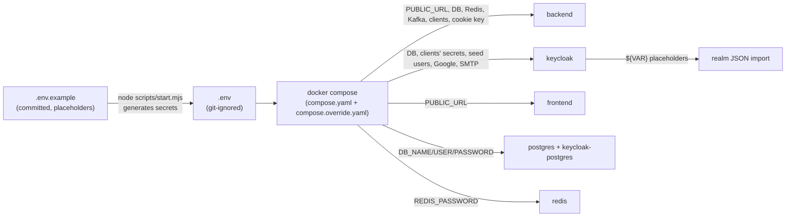

# Configuration

All configuration comes from **one file, `.env`**, at the repository root. Docker Compose reads it and hands each
container only the variables that container needs. Nothing secret is committed.



## 1. Setting it up

```bash
node scripts/start.mjs      # creates .env with generated secrets on first run
```

Or by hand: `cp .env.example .env`, then replace every `CHANGE_ME` (e.g. `openssl rand -base64 32`). After editing
`.env`, apply it with `docker compose up -d --wait` (containers whose variables changed are recreated). Variables that
feed the **realm import** (`*_CLIENT_SECRET`, `SEED_*`, `GOOGLE_*`, `SMTP_*`, `PUBLIC_URL`) only take effect on a fresh
import: `node scripts/start.mjs reset --yes` in development.

## 2. Every variable in `.env`

### General

| Variable | Example | Used by | Meaning |
|---|---|---|---|
| `PUBLIC_URL` | `http://localhost:8080` | backend, keycloak, frontend | The public origin (nginx). Every browser-visible URL, the token issuer, cookie scope, canonical URLs and sitemap derive from it. No trailing slash. |

### Databases (two separate Postgres servers)

| Variable | Example | Used by | Meaning |
|---|---|---|---|
| `APP_POSTGRES_SUPERUSER_PASSWORD` | random | postgres | Superuser of the app's Postgres (only used to create the app database and role) |
| `APP_DB_NAME` / `APP_DB_USER` | `superapp` | postgres, backend | App database and its owner role |
| `APP_DB_PASSWORD` | random | postgres, backend | Password of that role |
| `KEYCLOAK_POSTGRES_SUPERUSER_PASSWORD` | random | keycloak-postgres | Superuser of Keycloak's Postgres |
| `KEYCLOAK_DB_NAME` / `KEYCLOAK_DB_USER` | `keycloak` | keycloak-postgres, keycloak | Keycloak's database and role |
| `KEYCLOAK_DB_PASSWORD` | random | keycloak-postgres, keycloak | Password of that role |

### Redis

| Variable | Used by | Meaning |
|---|---|---|
| `REDIS_PASSWORD` | redis, backend | Required password (revocation markers, refresh de-duplication) |

### Keycloak

| Variable | Example | Used by | Meaning |
|---|---|---|---|
| `KEYCLOAK_REALM` | `superapp` | backend | Realm the BFF signs users into |
| `KEYCLOAK_BOOTSTRAP_ADMIN_USERNAME` / `_PASSWORD` | `admin` / random | keycloak | Temporary admin of the `master` realm, created on first start |
| `SUPERAPP_BFF_CLIENT_ID` | `superapp-bff` | backend | The confidential client used for sign-in |
| `SUPERAPP_BFF_CLIENT_SECRET` | random, 32+ chars | backend, keycloak (realm import) | Its secret; both sides must match |
| `SUPERAPP_ADMIN_CLIENT_ID` | `superapp-admin-api` | backend | Service-account client for the Admin API |
| `SUPERAPP_ADMIN_CLIENT_SECRET` | random, 32+ chars | backend, keycloak (realm import) | Its secret |
| `SEED_ADMIN_PASSWORD` / `SEED_USER_PASSWORD` | 12+ chars, upper, lower, digit | keycloak (realm import) | Passwords of `admin@superapp.local` and `user@superapp.local`. Remove or change for production |

### Google sign-in (optional)

| Variable | Used by | Meaning |
|---|---|---|
| `SUPERAPP_GOOGLE_LOGIN_ENABLED` | backend, keycloak | `true` shows *Continue with Google* on the landing and sign-in pages |
| `GOOGLE_CLIENT_ID` / `GOOGLE_CLIENT_SECRET` | keycloak (realm import) | Your Google OAuth client. Redirect URI to register: `${PUBLIC_URL}/auth/realms/<realm>/broker/google/endpoint` |

### Email (Keycloak's SMTP)

| Variable | Dev value | Meaning |
|---|---|---|
| `SMTP_HOST` / `SMTP_PORT` | `mailpit` / `1025` | Relay. Production: your provider |
| `SMTP_FROM` / `SMTP_FROM_DISPLAY_NAME` | `no-reply@superapp.local` / `SuperApp` | Sender |
| `SMTP_USER` / `SMTP_PASSWORD` | empty | Relay credentials |
| `SMTP_AUTH` / `SMTP_STARTTLS` / `SMTP_SSL` | `false` | Relay security (`true` strings) |

### BFF security

| Variable | Meaning |
|---|---|
| `BFF_COOKIE_ENCRYPTION_KEY` | 32 random bytes, base64. Master key for the cookie encryption (a key per cookie type is derived from it). Changing it signs everyone out |
| `BFF_COOKIE_SECURE` | `true` everywhere (browsers allow Secure cookies on `http://localhost`). `false` only for plain http on another host, never in production; it also drops the `__Host-` prefix |

## 3. Optional backend variables (not in `.env.example`)

Add them to the `backend` service's `environment` in `compose.yaml` if you need them.

| Variable | Default | Meaning |
|---|---|---|
| `DB_POOL_MAX_SIZE` / `DB_POOL_MIN_IDLE` | `20` / `5` | Hikari pool. Keep `instances × max` below Postgres `max_connections` (100) |
| `API_DOCS_ENABLED` | `true` | `false` turns Swagger UI and `/v3/api-docs` off |
| `SPRING_PROFILES_ACTIVE` | `docker` (set by compose) | Switches logs to JSON (ECS) |

Values compose sets itself (not in `.env`): `KAFKA_BOOTSTRAP_SERVERS=kafka:9092`,
`KEYCLOAK_KAFKA_BOOTSTRAP_SERVERS=keycloak-kafka:9092`, `KEYCLOAK_INTERNAL_URL=http://keycloak:8080/auth`,
`REDIS_HOST=redis`, `APP_DB_URL=jdbc:postgresql://postgres:5432/<APP_DB_NAME>`.

## 4. Backend settings (`backend/src/main/resources/application.yaml`)

Every value can be overridden with an environment variable (Spring's relaxed binding, e.g.
`SUPERAPP_BFF_REVOCATION_TTL=PT30M`).

| Key | Default | Meaning |
|---|---|---|
| `superapp.bff.public-url` | `${PUBLIC_URL}` | Public origin |
| `superapp.bff.default-return-path` | `/app` | Where users land after sign-in |
| `superapp.bff.revocation-ttl` | `PT15M` | Lifetime of a revocation marker (longer than an access token) |
| `superapp.bff.keycloak.internal-url` | `http://localhost:8180/auth` | Keycloak on the private network |
| `superapp.identity.google-login-enabled` | `false` | Google button flag for the landing page |
| `superapp.identity.events.bootstrap-servers` | `localhost:9095` | Keycloak's Kafka |
| `superapp.kafka.topics.keycloak-events` | `keycloak.events` | Topic name |
| `superapp.kafka.replicas` | `1` | Replication for topics the BFF creates (3 in production) |
| `superapp.user.reconciliation.cron` | `0 30 3 * * *` (UTC) | Nightly user repair |
| `superapp.user.reconciliation.max-erasures` | `50` | Safety cap per run |
| `server.port` / `management.server.port` | `8081` / `9090` | API / health and metrics |
| `spring.threads.virtual.enabled` | `true` | Java virtual threads |

## 5. Frontend settings

| Where | What |
|---|---|
| `PUBLIC_URL` (runtime env) | Canonical URLs, sitemap, robots, Open Graph (read per request, so one image serves every environment) |
| `LEGAL_DIR` (runtime env, optional) | Folder of the legal Markdown files (default `./legal`) |
| `frontend/next.config.ts` | Standalone output, security headers, dev-only forwarding of `/api`, `/oauth2`, `/login/oauth2`, `/auth` to `:8080` |
| `frontend/src/proxy.ts` | The per-request Content-Security-Policy |
| `frontend/src/lib/site.ts` | Product name, description, theme colors for metadata |

## 6. Keycloak settings

| Where | What |
|---|---|
| `keycloak/realm/superapp-realm.json` | The realm (see [keycloak.md](keycloak.md#3-the-realm)) |
| `keycloak/Dockerfile` (`ENV` before `kc.sh build`) | Build-time options: Postgres, `/auth`, health, metrics, features `passkeys,dpop,recovery-codes` |
| `compose.yaml` (`keycloak.environment`) | Runtime: hostname `${PUBLIC_URL}/auth`, proxy headers, DB pool 5–20, Kafka, back-channel URL |
| `KC_HOSTNAME_ADMIN` (`compose.override.yaml`) | Admin console on `http://localhost:8180/auth` in development |

## 7. Docker environment files

| File | Loaded | Purpose |
|---|---|---|
| `.env` | always (by Compose) | Values for `${VAR}` in the compose files |
| `compose.yaml` | always | The production-shaped stack: only nginx publishes a port |
| `compose.override.yaml` | automatically with `docker compose up` (development) | Publishes debug ports on `127.0.0.1` and the Keycloak admin hostname. Production: `docker compose -f compose.yaml up -d` ignores it |

Ports published in development (all on 127.0.0.1 except nginx):

| Port | Service |
|---|---|
| 8080 | nginx (the app) |
| 8081 / 9090 | backend API (Swagger) / actuator |
| 8180 | Keycloak (admin console) |
| 5432 / 5433 | app Postgres / Keycloak Postgres |
| 6379 | Redis |
| 9094 / 9095 | app Kafka / Keycloak Kafka |
| 8025 | Mailpit inbox |
