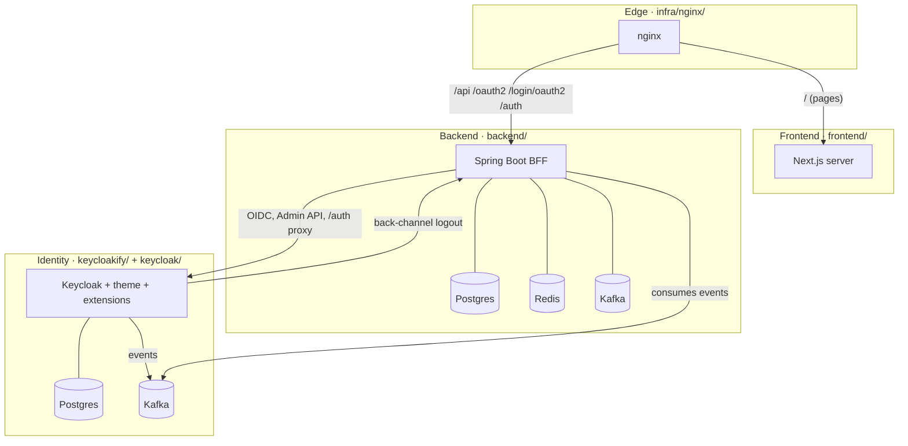

# Decoupled projects

The repository holds **four independent deployables**. They share no code and no build; they meet only through
URLs, environment variables and three small contracts. Each can move to its own repository, pipeline, team or server.



## 1. The four deployables

| Deployable | Folder(s) | Build context | Image | Language / tool |
|---|---|---|---|---|
| Edge | `infra/nginx/` | `infra/nginx/` | `superapp/nginx` | nginx config |
| Frontend | `frontend/` | `frontend/` | `superapp/frontend` | Next.js, npm |
| Backend (BFF) | `backend/` | `backend/` | `superapp/backend` | Java 25, Gradle |
| Identity | `keycloakify/`, `keycloak/` | repository root (the Dockerfile copies only these two folders) | `superapp/keycloak` | Keycloak 26.8, React theme (npm, Maven), extensions (Gradle) |

Build any one alone:

```bash
docker build -t superapp/nginx    infra/nginx
docker build -t superapp/frontend frontend
docker build -t superapp/backend  backend
docker build -t superapp/keycloak -f keycloak/Dockerfile .
```

Nothing in one folder imports from another. The two React projects each have their own copy of the shadcn kit and the
design tokens; the legal documents are copied into `frontend/legal` and `keycloak/legal` (the e2e suite fails if they
drift).

## 2. What each one needs (its whole configuration)

### Edge

| Variable | Example | Meaning |
|---|---|---|
| `FRONTEND_UPSTREAM` | `frontend:3000` | Where the Next.js server runs |
| `BACKEND_UPSTREAM` | `backend:8081` | Where the BFF runs |

Plus TLS certificates when it terminates HTTPS.

### Frontend

| Variable | Meaning |
|---|---|
| `PUBLIC_URL` | Public origin, for canonical URLs, sitemap, Open Graph |
| `LEGAL_DIR` (optional) | Folder with `terms.md` / `privacy.md` |

It calls nobody. Its server only renders pages; the browser calls `/api` on the same origin.

### Backend

| Variable | Meaning |
|---|---|
| `PUBLIC_URL` | Public origin (redirect URIs, cookie scope, issuer check) |
| `APP_DB_URL`, `APP_DB_USER`, `APP_DB_PASSWORD` | Its own Postgres |
| `REDIS_HOST`, `REDIS_PASSWORD` | Its own Redis |
| `KAFKA_BOOTSTRAP_SERVERS` | Its own Kafka |
| `KEYCLOAK_KAFKA_BOOTSTRAP_SERVERS` | Keycloak's Kafka (to read identity events) |
| `KEYCLOAK_INTERNAL_URL`, `KEYCLOAK_REALM` | Keycloak on the private network |
| `SUPERAPP_BFF_CLIENT_ID/SECRET`, `SUPERAPP_ADMIN_CLIENT_ID/SECRET` | Its two Keycloak clients |
| `BFF_COOKIE_ENCRYPTION_KEY`, `BFF_COOKIE_SECURE` | Cookie encryption |
| `SUPERAPP_GOOGLE_LOGIN_ENABLED` | Show the Google button |

### Identity (Keycloak)

| Variable | Meaning |
|---|---|
| `PUBLIC_URL`, `KC_HOSTNAME` (`${PUBLIC_URL}/auth`) | Public address of the sign-in pages and token issuer |
| `KC_DB_URL`, `KC_DB_USERNAME`, `KC_DB_PASSWORD` | Its own Postgres |
| `KAFKA_BOOTSTRAP_SERVERS`, `KAFKA_EVENTS_TOPIC` | Its own Kafka (event listener extension) |
| `SUPERAPP_BACKCHANNEL_LOGOUT_URL` | The BFF's back-channel logout endpoint on the private network |
| `SUPERAPP_BFF_CLIENT_SECRET`, `SUPERAPP_ADMIN_CLIENT_SECRET` | Must equal the backend's |
| `SMTP_*`, `GOOGLE_*`, `SEED_*`, `KC_BOOTSTRAP_ADMIN_*` | Mail, Google, seed users, first admin |

## 3. The contracts between them

These are the only things two teams must agree on.

| Contract | Between | Defined in | Change it carefully |
|---|---|---|---|
| **HTTP API** `/api/v1/**` (JSON, problem details, cookie + XSRF) | frontend ↔ backend | OpenAPI at `/v3/api-docs` (`*ApiDocs` interfaces) | Add fields freely; breaking changes get `/api/v2` (`version = "2"`) |
| **Auth navigation** `/oauth2/authorization/keycloak?returnTo=…&action=…`, `/api/auth/logout`, `?action=success\|cancelled\|error` | frontend ↔ backend | `src/lib/auth.ts` ↔ `LoginOptions.java` | Both sides list the allowed actions |
| **OIDC clients** (`superapp-bff`, `superapp-admin-api`), redirect URI, audience, roles `user`/`admin` | backend ↔ Keycloak | realm JSON ↔ `application.yaml` | Secrets equal on both sides |
| **Back-channel logout** `POST /api/auth/backchannel-logout` (logout token) | Keycloak → backend | realm JSON client attribute | Private network only |
| **Identity events** topic `keycloak.events`, JSON `IdentityEventMessage` | Keycloak → backend | `keycloak/extensions/.../IdentityEventMessage.java` ↔ backend consumer record | Add fields only; consumers ignore unknown fields |
| **Legal versions** front matter `version` | Keycloak ↔ frontend | `keycloak/legal/*.md` = `frontend/legal/*.md` | Raise `version` in both |
| **Routing** paths on one origin | edge ↔ everyone | `infra/nginx/templates/*.template` | Every path the browser needs must be routed |

## 4. Splitting into separate repositories

1. Create one repository per deployable and copy its folder(s) to the root:
   `infra/nginx/` → `superapp-edge`, `frontend/` → `superapp-web`, `backend/` → `superapp-bff`,
   `keycloakify/` + `keycloak/` (+ the root `.dockerignore`) → `superapp-identity`.
2. Give each its own CI: build, test (see [testing.md](testing.md)), push the image with an immutable tag (git SHA).
3. Keep a small **deployment repository** (or your platform's config) with `compose.yaml` / manifests and the
   environment for each environment. It is the only place that knows all four images.
4. Run the e2e suite (`frontend/e2e`) in the deployment pipeline against staging: it is the contract test for the whole
   system.
5. Version the contracts above: publish the OpenAPI document from the backend's CI; keep `IdentityEventMessage`
   backward compatible.

## 5. Running them on different hosts

| Rule | Why |
|---|---|
| The browser sees **one origin** for `/`, `/api`, `/oauth2`, `/login/oauth2`, `/auth` | `__Host-` cookies are host-only and `SameSite=Lax`; the sign-in pages must share that origin |
| The edge is the **only** public entry | The BFF trusts `X-Forwarded-*`; Keycloak's admin endpoints must stay private |
| Backend ↔ Keycloak on a **private** network (VPC, service mesh, WireGuard) | Admin API credentials, back-channel logout, token endpoint |
| Each data store reachable only by its owner | App data: backend only. Identity data: Keycloak only (plus the backend reading `keycloak.events`) |
| TLS between hosts when they cross untrusted networks | Set `KEYCLOAK_INTERNAL_URL=https://…`, Kafka with TLS/SASL, Postgres `sslmode=verify-full` |

Scaling: frontend and backend are stateless (no HTTP sessions; state is in cookies and Redis) and scale horizontally
behind the edge. Keycloak scales as a cluster (embedded Infinispan; see Keycloak's high-availability guide). Postgres, Redis and Kafka: managed services in production.
