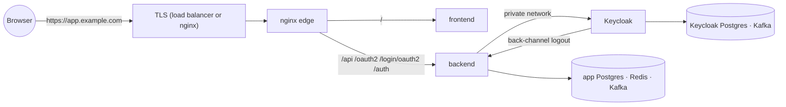

# Deployment

`compose.yaml` alone (without `compose.override.yaml`) is the production shape: only nginx publishes a port.

```bash
docker compose -f compose.yaml up -d --build --wait
```

Use it as is on a single host, or translate it to your orchestrator (Kubernetes, ECS, Nomad…).

## 1. Deploying the parts separately

Every deployable builds from its own folder, so each can live in its own repository, pipeline or server:

| Deployable | Build context | Needs to reach |
|---|---|---|
| nginx (edge) | `infra/nginx/` | frontend, backend (`FRONTEND_UPSTREAM`/`BACKEND_UPSTREAM` in its template) |
| frontend | `frontend/` | nothing (only receives requests from the edge) |
| backend (BFF) | `backend/` | Keycloak (internal URL), its Postgres, Redis, Kafka, Keycloak's Kafka |
| Keycloak | repository root (uses only `keycloakify/` + `keycloak/`) | its Postgres, its Kafka, SMTP, the BFF's back-channel URL |



The one rule: the browser must see **one origin** for the app, `/api`, `/oauth2`, `/login/oauth2` and `/auth`
(cookies are `__Host-`, same-site). The edge routes those paths to wherever each service runs; Keycloak is never
exposed on its own hostname.

Splitting the parts into separate repositories and hosts: [decoupled.md](decoupled.md).

## 2. Know this before you go to production

| Topic | What to know | Suggestion |
|---|---|---|
| **One public origin** | The app, `/api`, `/oauth2`, `/login/oauth2` and `/auth` must share one origin (`__Host-` cookies, Keycloak under `/auth`) | `app.example.com` for everything; no `auth.example.com` |
| **`PUBLIC_URL` is baked into the realm** | Redirect URIs, back-channel URL and Google's callback come from it at the **first** import | Set the final URL before the first production start; changing it later means editing the client in the admin console |
| **The realm imports once** | Later edits to `superapp-realm.json` are ignored on an existing database | Treat the JSON as the starting point; apply later changes with the Admin API, `kcadm.sh` or a tool like keycloak-config-cli, in your pipeline |
| **Keycloak's database is your user base** | Users, password hashes, passkeys, MFA secrets live there, not in the app's database | Back it up like your most important data; test restores |
| **Cookie key rotation signs everyone out** | `BFF_COOKIE_ENCRYPTION_KEY` decrypts every cookie | Rotate on a schedule you announce, or after a leak |
| **Revocation markers live in Redis** | Signing a device out is enforced through Redis for 15 minutes (longer than an access token) | Redis with persistence and `noeviction`, highly available: if it is unreachable, API requests fail rather than skip the check |
| **Access tokens live 5 minutes** | Revocation is instant through Redis; without Redis, a token stays valid until it expires | Keep it short; don't raise it to reduce load |
| **Email is part of sign-up** | Registration needs the verification email | Production SMTP with SPF, DKIM, DMARC before launch; check spam folders |
| **Google needs approval** | An unpublished OAuth consent screen allows only test users | Publish the consent screen; register the production redirect URI |
| **Legal versions** | Raising `version` makes every user accept again at next sign-in | Raise it only for material changes; update both copies |
| **Seed users and bootstrap admin** | The template creates `admin@…`/`user@…` and a temporary master admin | Remove seed users from the JSON before the first production import; replace the bootstrap admin |
| **Single-node Kafka and Postgres in compose** | Fine for development, not for availability | Managed Postgres (×2), managed Redis, 3-broker Kafka (or a managed service) |
| **Kafka events can be missed** | If the BFF is down for long, events wait in Kafka; the nightly reconciliation repairs gaps | Monitor consumer lag of group `superapp-identity`; alert on `.DLT` |
| **Memory** | The stack needs ~4 GB; Keycloak 1.5 GB, backend 1 GB | 2 vCPU / 8 GB minimum for a single host; more for Keycloak under load |
| **Images** | `:local` tags are for development | Build in CI, tag with the git SHA, scan images (Trivy, Grype), pull by digest |
| **Secrets** | `.env` is convenient, not a secret store | Docker/Kubernetes secrets, Vault, or your cloud's secret manager |
| **Swagger UI** | On the BFF's port only, never routed by nginx | `API_DOCS_ENABLED=false` in production unless you need it internally |
| **Observability** | Health, Prometheus metrics, ECS JSON logs exist; nothing collects them yet | Prometheus + Grafana (or your APM), central logs, alerts on 5xx rate, login failures, lag |

## 3. Suggested production topologies

| Size | Shape |
|---|---|
| Small (one server) | `compose.yaml` on one VM, TLS at nginx (Let's Encrypt), daily database dumps to object storage, Mailpit removed, real SMTP |
| Medium | Containers on a managed platform (ECS, Cloud Run, Kubernetes); managed Postgres ×2, managed Redis, managed Kafka; load balancer with TLS in front of nginx |
| Large | Kubernetes, 2+ replicas of frontend, backend and Keycloak (Keycloak in cluster mode), Kafka with 3 brokers, separate staging environment running the e2e suite on every deploy |

Rolling updates: frontend and backend are stateless, so replace them one by one. Flyway migrations must stay
backward compatible with the previous backend version (expand, then contract). Keycloak upgrades: read the release
notes, back up its database, upgrade in staging first.

## 4. Checklist

### Secrets and configuration

- [ ] Every secret in `.env` is unique and random (`openssl rand -base64 32`). Prefer your platform's secret store.
- [ ] `PUBLIC_URL` is the exact public origin (`https://app.example.com`, no trailing slash).
- [ ] `BFF_COOKIE_SECURE=true`; `BFF_COOKIE_ENCRYPTION_KEY` is 32 random bytes (rotating it signs everyone out).
- [ ] Seed users removed from the realm JSON (or disabled, passwords changed).
- [ ] `KEYCLOAK_BOOTSTRAP_ADMIN_*` used once to create a real admin with MFA, then the bootstrap admin deleted.

### Network and TLS

- [ ] TLS terminates at nginx (add a `listen 443 ssl` server) or a load balancer in front of it.
- [ ] HSTS once HTTPS works everywhere.
- [ ] Behind a load balancer or CDN: set nginx `real_ip_header` / `set_real_ip_from` so `$remote_addr` is the client
      (nginx overwrites `X-Forwarded-For` with it, and rate limits use it).
- [ ] BFF, Keycloak, databases, Redis and Kafka reachable **only** on the private network. The BFF trusts
      `X-Forwarded-*` (`trusted-proxies: ".*"`), which is safe only while nginx is its sole ingress.
- [ ] `/api/auth/backchannel-logout` stays blocked at the edge (already in the template).

### Keycloak

- [ ] `KC_HOSTNAME=${PUBLIC_URL}/auth`; admin console on an internal hostname (`KC_HOSTNAME_ADMIN`) or not exposed.
- [ ] Real SMTP (`SMTP_*`) with SPF/DKIM; send a test email from the admin console. Remove Mailpit.
- [ ] Google OAuth client with the production redirect URI `${PUBLIC_URL}/auth/realms/<realm>/broker/google/endpoint`,
      consent screen published.
- [ ] Realm changes after go-live through the Admin API or a migration tool, never by re-importing.
- [ ] Backups of Keycloak's database (users, credentials, passkeys).

### Data and messaging

- [ ] Managed Postgres with backups and point-in-time recovery, for both databases.
- [ ] Redis with password and persistence (revocation markers must survive restarts; they expire on their own).
- [ ] Kafka with 3 brokers per cluster: `SUPERAPP_KAFKA_REPLICAS=3` for the topics the BFF creates; create
      `keycloak.events` with replication 3 yourself or let the extension create it.
- [ ] Alert on messages in `.DLT` topics; each one needs a human.

### Operations

- [ ] Health: nginx `/nginx-health`; BFF `:9090/actuator/health/readiness`; Keycloak `:9000/auth/health/ready`.
- [ ] Metrics: `:9090/actuator/prometheus` (BFF), `:9000/auth/metrics` (Keycloak). Management ports stay internal.
- [ ] API docs: `API_DOCS_ENABLED=false`, or keep the BFF port private (nginx never routes `/swagger-ui` or `/v3`).
- [ ] Capacity: `instances × DB_POOL_MAX_SIZE` (default 20) below Postgres `max_connections`.
- [ ] Logs: the `docker` profile writes ECS JSON; ship them to your log store.
- [ ] Rate limits reviewed for real traffic (`infra/nginx/nginx.conf` zones, bursts in the template).
- [ ] e2e against staging: `E2E_BASE_URL=https://staging.example.com npm --prefix frontend run e2e` (needs a reachable
      mail API, or adapt `linkFromEmail` in `frontend/e2e/tests/support.ts`).

Security background: [security.md](security.md).
