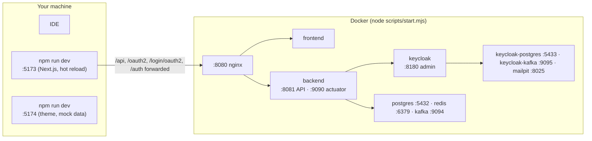

# Local development

Everything runs in Docker; you only run a dev server for the part you are working on. First time:
[getting-started.md](getting-started.md).

## 1. Daily workflow

| Goal | Command (from the repository root) |
|---|---|
| Start or rebuild everything | `node scripts/start.mjs` |
| Rebuild one service after a change | `docker compose up -d --build --wait backend` (or `frontend`, `keycloak`, `nginx`) |
| Follow logs | `node scripts/start.mjs logs backend` |
| App with hot reload (stack running) | `npm --prefix frontend run dev` → <http://localhost:5173> |
| Sign-in pages with mock data | `npm --prefix keycloakify run dev` → <http://localhost:5174/?kc=login.ftl> |
| Backend tests (Docker running) | `cd backend && ./gradlew test` |
| Type check and lint | `npm run typecheck` and `npm run lint` in `frontend/` or `keycloakify/` |
| End-to-end tests (stack running) | `npm --prefix frontend run e2e` |
| API docs | <http://localhost:8081/swagger-ui.html> (JSON: `/v3/api-docs`) |
| Stop (keep data) | `node scripts/start.mjs stop` |
| Wipe all local data | `node scripts/start.mjs reset --yes` |



## 2. Which change needs which rebuild

| You changed | Do |
|---|---|
| `backend/**` | `docker compose up -d --build --wait backend` |
| `frontend/**` | nothing while `npm run dev` runs; rebuild `frontend` to see it on :8080 |
| `keycloakify/**`, `keycloak/themes/**`, `keycloak/extensions/**` | rebuild `keycloak` (about a minute) |
| `keycloak/realm/**` | `node scripts/start.mjs reset --yes` (the realm is imported only into an empty database) |
| `keycloak/legal/*.md` (+ the same file in `frontend/legal/`) | rebuild `keycloak` and `frontend`; raise `version` only when users must accept again |
| `infra/nginx/**` | rebuild `nginx` |
| `.env` | `docker compose up -d --wait` (realm-related values need a reset, see [configuration.md](configuration.md)) |
| `compose*.yaml` | `docker compose up -d --wait` |

## 3. Working on each part

### Backend from your IDE

Run the stack, stop the container (`docker compose stop backend`), then run `SuperAppApplication` from the IDE with
the variables from `.env` plus the local addresses (debug ports are published on 127.0.0.1):

```text
APP_DB_URL=jdbc:postgresql://localhost:5432/superapp   REDIS_HOST=localhost   KAFKA_BOOTSTRAP_SERVERS=localhost:9094
KEYCLOAK_INTERNAL_URL=http://localhost:8180/auth        superapp.identity.events.bootstrap-servers=localhost:9095
```

nginx still points at the container, so test the API at <http://localhost:8081> (Swagger UI) or start the container
again when you want the full flow through :8080.

### Frontend

`npm --prefix frontend run dev` serves the app on :5173 and forwards `/api`, `/oauth2`, `/login/oauth2` and `/auth` to
:8080, so you sign in for real. Sign-in returns you to :8080 (the public URL); open :5173 again afterwards, your
cookies are shared because both are `localhost`.

### Keycloak theme

`npm --prefix keycloakify run dev`, then <http://localhost:5174/?kc=login.ftl> (any page id: `register.ftl`,
`login-otp.ftl`, `legal-consent.ftl`…). Mock data lives in `src/login/KcPageMock.ts`. To see it inside the real
Keycloak, rebuild the `keycloak` image. Full guide: [keycloak.md](keycloak.md#customizing-the-theme-step-by-step).

### Keycloak extensions

```bash
./backend/gradlew -p keycloak/extensions build      # compile + LegalConsentTest (uses the backend's wrapper)
```

The `keycloak` image builds them again in Docker, so you don't need a local JDK for that.

## 4. Recipes

### Add a backend feature

Use `user` as the reference for shape (public facade + `internal`). For a feature called `notes`:

1. `com.superapp.notes` holds only what other features may use: a facade interface, events, DTOs. Everything else goes
   in `com.superapp.notes.internal` (package-private where possible). `ArchitectureTest` enforces this.
2. Schema: a new Flyway migration `backend/src/main/resources/db/migration/V<n>__<what>.sql`. Never edit an applied
   migration; `ddl-auto` is `none`.
3. Controller: `@RequestMapping(path = "/api/{version}/notes", version = "1")` (see `MeController`), records for
   requests and responses, Bean Validation on inputs, `CurrentUser` as a parameter for the signed-in user.
4. Errors: throw a `DomainException` (stable slug, title, detail); never write error bodies by hand.
5. API docs: every `@Operation`/`@ApiResponse` and parameter constraint goes in `notes/internal/docs/NotesApiDocs.java`
   (an interface the controller `implements`), never on the controller. Hide `CurrentUser` with
   `@Parameter(hidden = true)`. `OpenApiConfig` adds shared 400/401/403/429/500 responses and the security schemes.
6. Events: declare the topic and its `.DLT` in `KafkaTopicsConfig`, publish with `KafkaTemplate`, consume with
   `@KafkaListener`, make consumers idempotent.
7. Tests: unit tests for the service and a slice in `ApiIntegrationTest` (MockMvcTester, Testcontainers).

Conventions: Java 25 (records, sealed types, pattern matching, `_` for unused), JSpecify `@NullMarked` packages,
constructor injection, `-Werror`, no deprecated APIs. Claude Code: skill `add-backend-feature`.

### Add a frontend page

1. Route: `frontend/src/app/app/<name>/page.tsx`, a small server component that exports `metadata` and renders a view.
   Everything under `/app` is signed-in only and `noindex`. Admin pages go under `app/app/admin/`.
2. View: `frontend/src/views/<name>.tsx` (`'use client'`), composed from `@/components/ui/*`, with loading, empty and
   error states.
3. Data: hooks in `src/lib/queries.ts` (keys in `keys`); requests only through `src/lib/api.ts`. Client state that
   outlives a component: a Zustand store created per provider (see `src/stores/admin-users-store.tsx`).
4. Navigation: add it to the sidebar in `src/layout/`.
5. Account actions (password, passkey, MFA, delete account) are full-page navigations: `runAction('…')`. Allowed
   actions are listed in `LoginOptions.java` and `src/lib/auth.ts`; add to both.
6. Public pages: `metadata` with a `canonical` URL, and an entry in `src/app/sitemap.ts`.

Claude Code: skill `add-frontend-page`.

### Change a Keycloak page

1. Find the page id (`window.kcContext.pageId` in the browser console on that page).
2. Edit its component under `keycloakify/src/login/pages/` (mapping in `KcPage.tsx`).
3. Preview at `http://localhost:5174/?kc=<page-id>`.
4. Texts: override message keys in `src/login/i18n.ts`.
5. Rebuild `keycloak` and run the e2e suite.

Claude Code: skill `change-keycloak-page`.

### Add a database column

```sql
-- backend/src/main/resources/db/migration/V2__user_locale.sql
alter table app_user add column locale varchar(16);
```

Rebuild `backend`; Flyway applies it on start. Then map it in the entity and expose it where needed.

## 5. Code quality gates

| Project | Command | Must be |
|---|---|---|
| backend | `./gradlew test` | green, zero compiler warnings (`-Werror`) |
| frontend | `npm run typecheck && npm run lint && npm run build` | clean |
| keycloakify | `npm run typecheck && npm run lint` | clean |
| everything a user sees | `npm --prefix frontend run e2e` | green |

Biome formats and sorts imports: `npm run lint -- --write` fixes what it can. More: [testing.md](testing.md).
Problems: [troubleshooting.md](troubleshooting.md).
