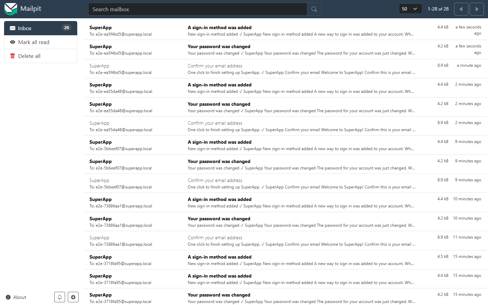

# Docker

The whole product runs as ten containers defined in `compose.yaml` (production shape) and `compose.override.yaml`
(development additions). Five are built from this repository; five use official images.

## 1. Services

| Service | Image | Built from | Role | Networks | Health check |
|---|---|---|---|---|---|
| `nginx` | `superapp/nginx:local` | `infra/nginx/` | The only public entry point; routes paths; per-IP rate limits | edge, web | `GET /nginx-health` |
| `frontend` | `superapp/frontend:local` | `frontend/` | Next.js server: renders pages, sets the CSP | web | `GET /manifest.webmanifest` |
| `backend` | `superapp/backend:local` | `backend/` | The BFF: sign-in, API, `/auth` proxy, revocation, user sync | edge, app-net, identity-net | actuator readiness on :9090 |
| `keycloak` | `superapp/keycloak:local` | root (uses `keycloakify/` + `keycloak/`) | Identity provider | identity-net, keycloak-db | ready **and** realm imported |
| `postgres` | `postgres:18.6` | — | App database | app-net | `pg_isready` + database exists |
| `keycloak-postgres` | `postgres:18.6` | — | Keycloak's database | keycloak-db | same |
| `redis` | `redis:8.10.2` | — | Revocation markers, refresh de-duplication | app-net | `PING` |
| `kafka` | `apache/kafka:4.3.1` | — | App event broker (KRaft, no ZooKeeper) | app-net | broker API answers |
| `keycloak-kafka` | `apache/kafka:4.3.1` | — | Keycloak's event broker | identity-net | broker API answers |
| `mailpit` | `axllent/mailpit:v1.31.4` | — | Development SMTP sink with a web inbox | identity-net | built in |

Start order is enforced with `depends_on: condition: service_healthy`: databases and brokers → Keycloak → backend →
frontend and nginx. `docker compose up --wait` returns only when everything is healthy.

## 2. Networks

| Network | Members | Why |
|---|---|---|
| `edge` | nginx, backend | nginx → BFF |
| `web` | nginx, frontend | nginx → Next.js; the frontend reaches nothing else |
| `app-net` | backend, postgres, redis, kafka | The app's data, private to the BFF |
| `identity-net` | backend, keycloak, keycloak-kafka, mailpit | BFF ↔ Keycloak, Keycloak's events and mail |
| `keycloak-db` | keycloak, keycloak-postgres | Only Keycloak reaches its database |

## 3. Volumes (your data)

| Volume | Holds | Lost by |
|---|---|---|
| `postgres-data` | App database (`app_user`, Flyway history) | `reset --yes` / `down -v` |
| `keycloak-postgres-data` | Users, credentials, passkeys, sessions, realm | same |
| `redis-data` | Revocation markers (append-only file) | same |
| `kafka-data` / `keycloak-kafka-data` | Topics and consumer offsets | same |

`node scripts/start.mjs stop` keeps volumes. Volume names are prefixed with the Compose project name (`superapp_…`).

## 4. How each image is built

| Image | Stages | Result |
|---|---|---|
| backend | JDK 25: `gradlew bootJar` (dependencies cached in a layer) → extract Spring Boot layers → JRE 25 | Non-root user 10001, layered for fast rebuilds, compact object headers, heap 75 % of the container limit |
| frontend | `npm ci` → `next build` (standalone) → slim Node 24 | Non-root user 10001; only `server.js`, the standalone bundle, static assets and `legal/` |
| keycloak | theme (Maven + Node: Keycloakify JAR) → spi (Gradle: extensions, tests) → JDK 25 + Keycloak 26.8 distribution + `kc.sh build` → JRE 25 runtime | Non-root user 1000, optimized start; see [keycloak.md](keycloak.md#1-how-the-keycloak-image-is-built) |
| nginx | `nginx-unprivileged` + config + template | Runs as user 101 on port 8080 |

Build caches (`--mount=type=cache`) keep Gradle, npm and Maven downloads between builds.

## 5. Tuning and hardening

| Service | Memory limit | Notable settings |
|---|---|---|
| nginx | 128 MB | read-only root, tmpfs for cache and config, all capabilities dropped |
| frontend | 512 MB | read-only root, tmpfs `.next/cache` and `/tmp`, all capabilities dropped |
| backend | 1 GB | read-only root, tmpfs `/tmp`, all capabilities dropped; Hikari pool 20; virtual threads |
| keycloak | 1.5 GB | all capabilities dropped; DB pool 5–20; heap 70 % |
| postgres ×2 | 1 GB each | `shared_buffers=256MB`, `effective_cache_size=768MB`, `work_mem=8MB`, `max_connections=100`, `idle_in_transaction_session_timeout=60s`, `lock_timeout=10s`, slow-query log ≥ 500 ms, SCRAM passwords, 256 MB shm |
| redis | 512 MB | password, append-only persistence, `noeviction` (revocation markers must never be evicted) |
| kafka ×2 | 1 GB each | heap 256–512 MB; app cluster: auto-create off (topics declared by the BFF); Keycloak's: auto-create off (topic created by Keycloak's extension) |
| mailpit | 128 MB | keeps at most 1000 messages |

Every service: `restart: unless-stopped`, `no-new-privileges`, JSON logs rotated at 10 MB × 3.

## 6. Everyday commands

| Task | Command |
|---|---|
| Start / rebuild everything | `node scripts/start.mjs` |
| Rebuild one service after a change | `docker compose up -d --build --wait backend` (or `frontend`, `keycloak`, `nginx`) |
| Status | `node scripts/start.mjs status` |
| Logs | `node scripts/start.mjs logs keycloak` |
| Stop (keep data) | `node scripts/start.mjs stop` |
| Wipe data and start fresh | `node scripts/start.mjs reset --yes` |
| Production shape (no debug ports) | `docker compose -f compose.yaml up -d --build --wait` |

## 7. Looking inside

| What | Command |
|---|---|
| App database | `docker compose exec postgres psql -U superapp -d superapp` (`\dt`, `select * from app_user;`) |
| Keycloak database | `docker compose exec keycloak-postgres psql -U keycloak -d keycloak` |
| Redis | `docker compose exec redis sh -c 'redis-cli -a "$REDIS_PASSWORD" --no-auth-warning keys "bff:*"'` |
| Keycloak's topic | `docker compose exec keycloak-kafka /opt/kafka/bin/kafka-console-consumer.sh --bootstrap-server localhost:9092 --topic keycloak.events --from-beginning` |
| App topics | `docker compose exec kafka /opt/kafka/bin/kafka-topics.sh --bootstrap-server localhost:9092 --list` |
| Consumer lag | `docker compose exec keycloak-kafka /opt/kafka/bin/kafka-consumer-groups.sh --bootstrap-server localhost:9092 --describe --group superapp-identity` |
| Emails | <http://localhost:8025> |
| Backend health / metrics | <http://localhost:9090/actuator/health> · <http://localhost:9090/actuator/prometheus> |
| API docs | <http://localhost:8081/swagger-ui.html> |
| Keycloak admin console | <http://localhost:8180/auth> |

From a database GUI (DBeaver, DataGrip, pgAdmin): `localhost:5432` (app) or `localhost:5433` (Keycloak) with the
users and passwords from `.env`.

