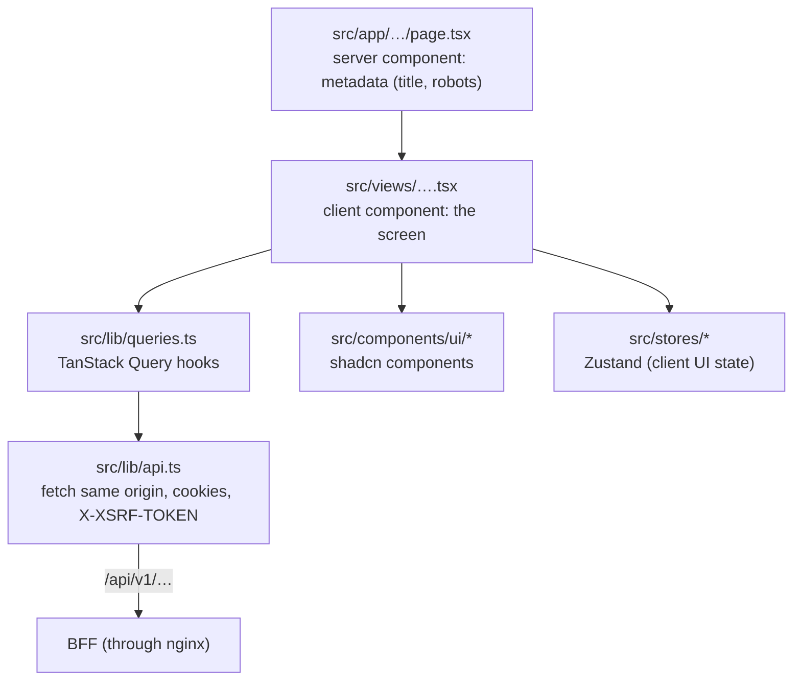

# Frontend (the product app)

Next.js 16 (App Router) with React 19, TypeScript 7, Tailwind CSS 4, shadcn/ui, TanStack Query 5 and Zustand 5. It runs
as its own server behind nginx and **talks to nobody**: the browser calls the BFF; the Next.js server only renders
pages.

| Landing | Signed-in home |
|---|---|
|  |  |

## 1. Pages

| URL | Who | What | Screenshot |
|---|---|---|---|
| `/` | everyone | Landing page with sign-in / get started | [landing](images/landing.png) · [dark](images/landing-dark.png) · [phone](images/landing-mobile.png) |
| `/legal/terms`, `/legal/privacy` | everyone | Legal documents (rendered on the server from `legal/*.md`) | [terms](images/legal-terms.png) |
| `/app` | signed in | Home | [home](images/app-home.png) · [dark](images/app-home-dark.png) · [phone](images/app-mobile.png) |
| `/app/settings` | signed in | Profile | [profile](images/settings-profile.png) |
| `/app/settings/security` | signed in | Password, passkeys, authenticator, recovery codes, Google | [security](images/settings-security.png) |
| `/app/settings/sessions` | signed in | Devices | [devices](images/settings-devices.png) |
| `/app/admin` | role admin | Overview and users | [admin](images/admin-overview.png) |
| `/app/admin/users/[id]` | role admin | One user: sign-in methods, live sessions | [user](images/admin-user.png) |

## 2. How a page is built



- **Routes stay thin.** `src/app/**/page.tsx` are server components that set metadata and render a view.
- **Screens are client components** in `src/views/` (they use hooks, fetch data, react to clicks).
- **Server state** (anything from the API) lives in TanStack Query: cached, de-duplicated, refreshed on focus. Query
  keys are in `keys` in `src/lib/queries.ts`; mutations invalidate what they change.
- **Client UI state** that must outlive a component (e.g. the admin list's page while you open a user) lives in a
  Zustand store created **per provider** (`src/stores/admin-users-store.tsx`), never a module-level store, so the
  server never shares state between requests.
- **Auth is navigation, not API calls.** `src/lib/auth.ts`: `signIn()`, `signUp()`, `withGoogle()`,
  `runAction('CONFIGURE_TOTP' | 'UPDATE_PASSWORD' | 'webauthn-register-passwordless' | …)`, `signOut()`. They send the
  browser to `/oauth2/authorization/keycloak?…`; the BFF does the rest.
- **Guards.** `RequireAuth` (all of `/app`) sends anonymous users to sign-in; `RequireRole` hides admin pages from
  non-admins. The BFF enforces the same rules; the guards only avoid dead ends.
- **Results of account actions** come back as `?action=success|cancelled|error` (or `?auth_error=…`); a small component
  shows a toast and cleans the URL.

## 3. Security in the frontend

| What | Where |
|---|---|
| Strict CSP with a fresh nonce on every page request | `src/proxy.ts` |
| Security headers, no `X-Powered-By` | `next.config.ts` |
| Pages render per request (needed for the nonce) | root layout reads the nonce |
| No tokens anywhere; only same-origin requests with the XSRF header | `src/lib/api.ts` |
| No network route to the BFF or Keycloak from the server | `compose.yaml` (network `web`) |

## 4. SEO and metadata

| File | Produces |
|---|---|
| `src/app/layout.tsx` | Title template (`%s · SuperApp`), description, Open Graph, Twitter card, theme colors, `metadataBase` from `PUBLIC_URL` |
| `src/app/page.tsx` | Canonical URL, JSON-LD (`WebApplication`) with the CSP nonce |
| `src/app/robots.ts` | `robots.txt`: index public pages; block `/app`, `/api`, `/auth`, `/oauth2`, `/login` |
| `src/app/sitemap.ts` | `sitemap.xml` with the public pages |
| `src/app/manifest.ts` | Web app manifest |
| `src/app/opengraph-image.tsx` | Social preview image (generated at build) |
| `src/app/icon.svg` | Favicon |
| `src/app/app/layout.tsx` | `noindex` for the whole signed-in area |

## 5. Look and feel

- Tokens (colors, radius, fonts) in `src/styles/globals.css`; components only use tokens (`bg-primary`,
  `text-muted-foreground`…), so light and dark mode both work. The theme toggle offers light, dark and system.
- Font: Geist (via `next/font`, self-hosted, no layout shift).
- Responsive: phones get a compact menu and smaller headings; from 1680 px the whole UI scales one step and the
  landing page widens, so 1080p screens aren't half empty.
- shadcn components live in `src/components/ui`. Add one with `cd frontend && npx shadcn@latest add <name>`.

## 6. Developing

```bash
cd frontend && npm install
npm run dev            # http://localhost:5173 (stack must be running for sign-in and API)
npm run typecheck      # route types + TypeScript + e2e types
npm run lint           # Biome: lint rules + sorted imports
npm run build          # production build (fails on type errors)
npm run e2e            # Playwright against http://localhost:8080
```

In development `next.config.ts` forwards `/api`, `/oauth2`, `/login/oauth2` and `/auth` to the stack on :8080, so the
app at :5173 signs in for real. Adding a page: [development.md](development.md#add-a-frontend-page).
