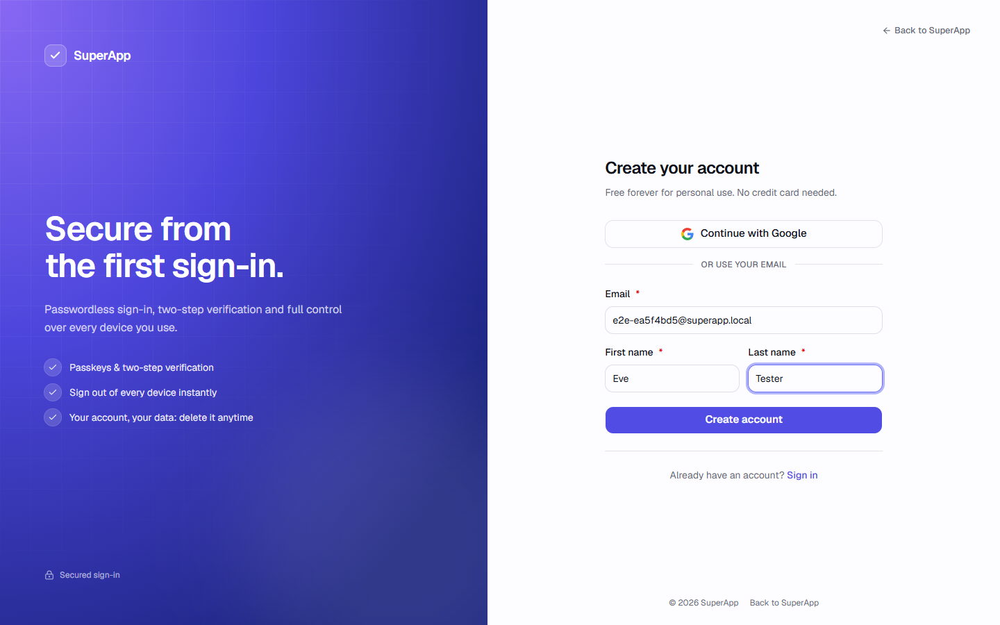
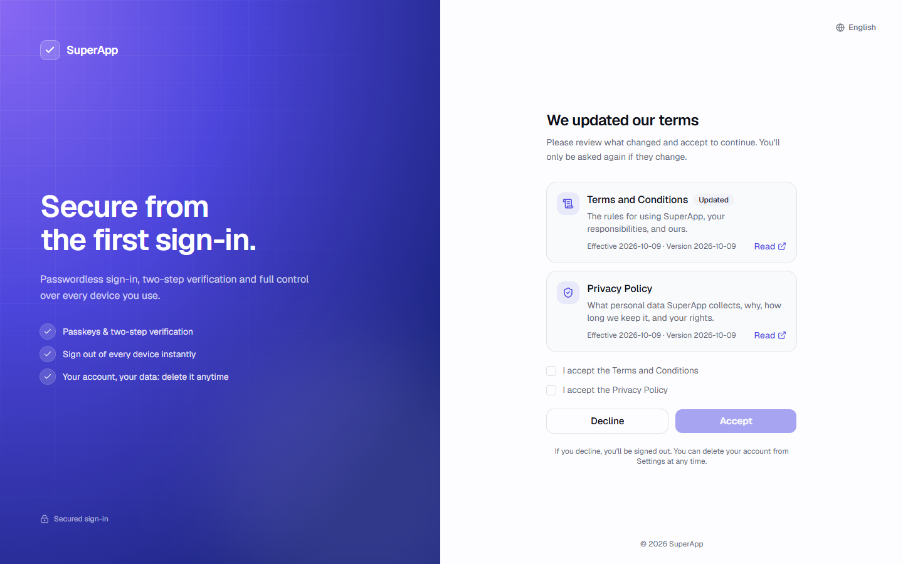
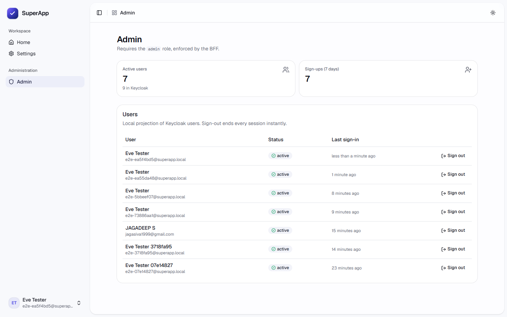

# Getting started

From nothing to a running app in about ten minutes (most of it is the first image download).


## 1. Install the prerequisites

| Tool | Version | Why | Check |
|---|---|---|---|
| Docker Desktop (Windows/macOS) or Docker Engine + Compose v2 (Linux) | current | runs every service | `docker compose version` |
| Node.js | 22 or newer | the start script, the two web projects | `node --version` |
| Git | any recent | cloning, the project generator | `git --version` |
| JDK 25 | optional | only to run backend tests or the backend outside Docker | `java --version` |

Give Docker at least **6 GB of memory** (Docker Desktop → Settings → Resources). The full stack uses about 4 GB.

## 2. Start everything with one command

```bash
node scripts/start.mjs
```

What it does, step by step:

1. Checks Node ≥ 22, that Docker is running and that Compose v2 exists.
2. **First run:** creates `.env` from `.env.example` and replaces every `CHANGE_ME` value with a freshly generated random
   secret (the cookie key gets exactly 32 bytes). Later runs only **add** keys that `.env.example` gained; your values
   are never changed.
3. Builds the five project images and starts all ten containers (`docker compose up -d --build --wait`).
4. Waits until every container reports **healthy**.
5. Prints where everything is. Passwords are never printed; it tells you which `.env` key holds each one.

```text
✔ Everything is up and healthy.

  App (landing, sign-in, app)   http://localhost:8080
  Emails (Mailpit inbox)        http://localhost:8025
  API docs (Swagger UI)         http://localhost:8081/swagger-ui.html
  Keycloak admin console        http://localhost:8180/auth   user "admin", password: KEYCLOAK_BOOTSTRAP_ADMIN_PASSWORD in .env

  Seed users (realm "superapp"):
    admin@superapp.local   role admin   password: SEED_ADMIN_PASSWORD in .env
    user@superapp.local    role user    password: SEED_USER_PASSWORD in .env
```

The first run downloads base images and dependencies (Gradle, npm, Maven for the theme) and takes 5–10 minutes.
Later runs reuse Docker's cache and start in about a minute.

### Other commands

| Command | Effect |
|---|---|
| `node scripts/start.mjs status` | Every container, its health and its ports |
| `node scripts/start.mjs logs` | Follow all logs (`logs backend`, `logs keycloak`, … for one service) |
| `node scripts/start.mjs stop` | Stop everything; **data is kept** |
| `node scripts/start.mjs reset --yes` | Stop and **delete all local data** (users, databases, Kafka, Redis), then start fresh. Needed after changing the realm JSON. |

## 3. Try it

### Create an account

1. Open <http://localhost:8080> and click **Get started**.
2. You land on the themed Keycloak sign-up page (served through the BFF at `/auth/...`; the browser never talks to
   Keycloak directly). Enter an email and your name.

   

3. Accept the Terms and Privacy Policy (shown once per document version).

   

4. Open Mailpit at <http://localhost:8025>, open the verification email and click the link.

   

   

5. Choose a password. You are signed in and land on the app.

   

### Look around

| Screen | Where | What you can do |
|---|---|---|
| Profile | Settings → Profile | See your account, edit name or email on Keycloak's page, delete the account |
| Security | Settings → Security | Change password, add a passkey, set up an authenticator app, recovery codes, link Google |
| Devices | Settings → Devices | Every signed-in device; sign one out, all others, or everywhere |
| Admin | Sidebar → Admin (role `admin` only) | Users overview, each user's sign-in methods and live sessions |


### Use the admin area

Sign in as `admin@superapp.local` (password: `SEED_ADMIN_PASSWORD` in `.env`), or give your own account the `admin`
role in the Keycloak admin console (<http://localhost:8180/auth> → realm *superapp* → Users → your user → Role mapping).
Sign out and in again so the new role is in your token.




## 4. Develop with hot reload

The stack keeps running; you start a dev server next to it.

| You work on | Command | Open |
|---|---|---|
| The product app (`frontend/`) | `npm --prefix frontend run dev` | <http://localhost:5173> |
| The sign-in pages (`keycloakify/`) | `npm --prefix keycloakify run dev` | <http://localhost:5174/?kc=login.ftl> |
| The backend (`backend/`) | `docker compose up -d --build --wait backend` | <http://localhost:8080> |

The app dev server forwards `/api`, `/oauth2`, `/login/oauth2` and `/auth` to the running stack, so sign-in works
exactly like production. The theme preview renders any Keycloak page with mock data: replace `login.ftl` with e.g.
`register.ftl`, `login-otp.ftl` or `legal-consent.ftl`.

Run `npm install` once in `frontend/` and `keycloakify/` before using their dev servers.

## 5. When something is off

| Symptom | Fix |
|---|---|
| `Docker is not running` | Start Docker Desktop and wait until it says *running*. |
| A service is not healthy | `node scripts/start.mjs logs <service>`; most often memory (give Docker more) or a port in use. |
| Port 8080/8025/8180/5432… already in use | Stop the other program, or change the left side of the port in `compose.override.yaml`. |
| Sign-in loops back to the start page | Cookies from an older run: clear site data for `localhost:8080`. |
| Changed the realm JSON but nothing changed | The realm imports only into an empty database: `node scripts/start.mjs reset --yes`. |
| Google says `redirect_uri_mismatch` | Register `<PUBLIC_URL>/auth/realms/<realm>/broker/google/endpoint` on your Google OAuth client. A project generated from the template has its own realm name, so it needs its own URI ([details](template.md#google-sign-in-in-a-new-project)). |

More in [troubleshooting.md](troubleshooting.md).

## Next

- How it fits together: [architecture.md](architecture.md)
- Every setting: [configuration.md](configuration.md)
- Changing anything (name, colors, pages, emails, roles): [customization.md](customization.md)
