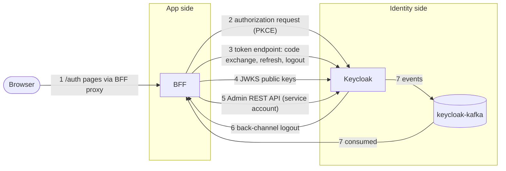
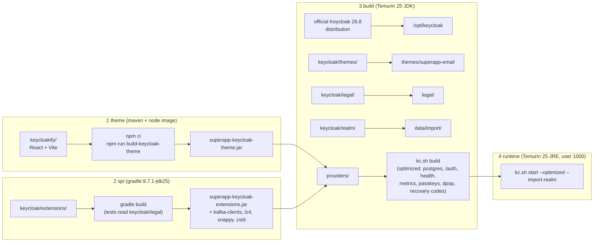
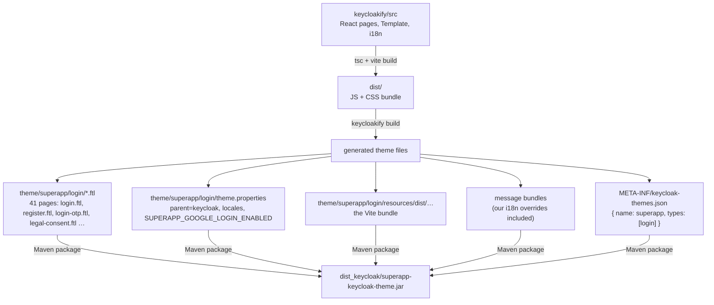
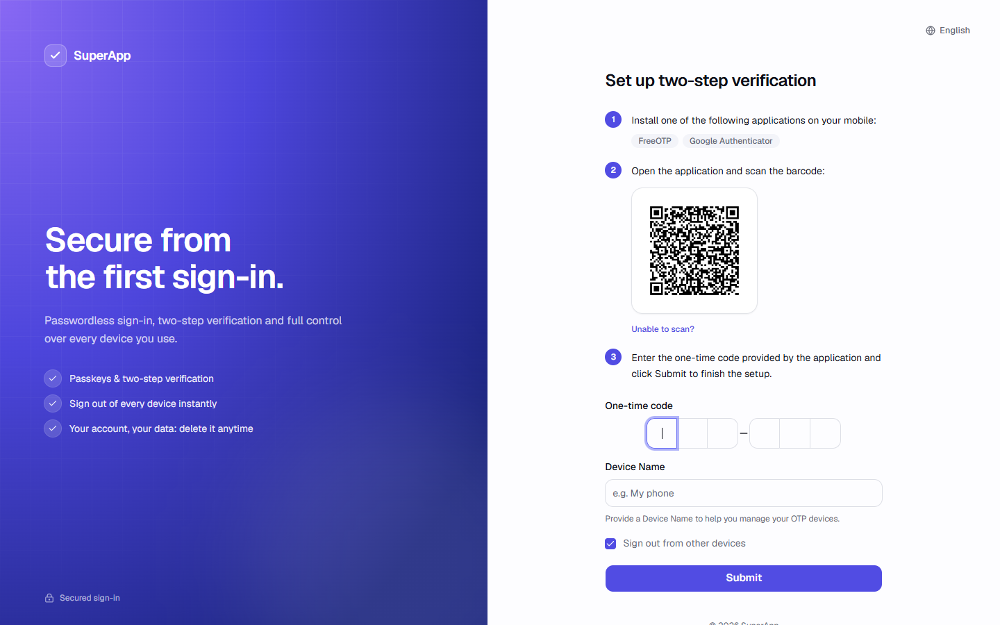
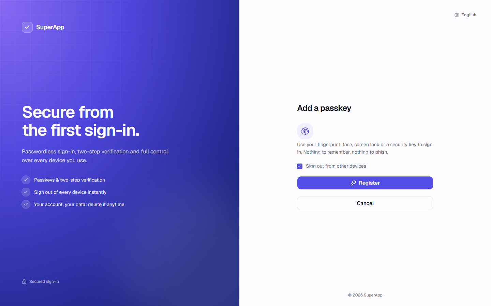
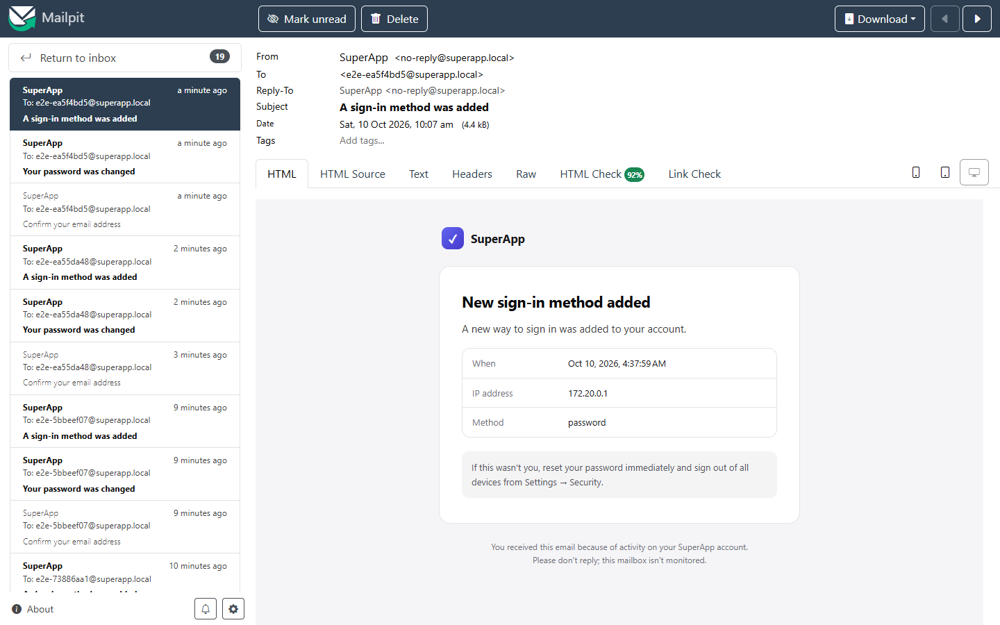

# Keycloak

Keycloak 26.8 on Eclipse Temurin 25 does all authentication. Everything about it is configuration as code in two
folders:

| Path | What |
|---|---|
| `keycloak/Dockerfile` | Builds the Keycloak image: theme JAR + extensions + email theme + realm + legal documents |
| `keycloak/realm/superapp-realm.json` | The realm: clients, roles, groups, flows, password policy, brute force, IdP, SMTP, seed users |
| `keycloak/themes/superapp-email/` | Email theme (FreeMarker HTML + plain-text bundle) |
| `keycloak/extensions/` | Our Java providers: Kafka event listener `superapp-kafka`, required action `superapp-legal-consent` |
| `keycloak/legal/` | Terms and Privacy Policy that users accept (their `version` is what Keycloak records) |
| `keycloakify/` | The sign-in pages (React), built into a theme JAR |


## How Keycloak works (the concepts you need)

| Concept | In this template |
|---|---|
| **Realm**: an isolated space with its own users, roles, clients, settings and theme | `superapp` (renamed with your project). `master` is Keycloak's own admin realm, never used by the app |
| **Client**: an application allowed to ask Keycloak for sign-ins or tokens | `superapp-bff` (the BFF signs users in) and `superapp-admin-api` (the BFF reads and manages users) |
| **User**: an account; credentials (password, OTP, passkeys) are stored by Keycloak only | Seed users plus everyone who signs up |
| **Roles and groups** | Realm roles `user`, `admin`; group `Admins` grants `admin` |
| **Authentication flow**: the steps of a sign-in (form, OTP, passkey, Google…) | Keycloak's built-in browser flow; plus required actions (verify email, legal consent, set password) |
| **Required action**: a step a user must complete at sign-in | `VERIFY_EMAIL`, `UPDATE_PASSWORD`, our `superapp-legal-consent`, MFA setup on request |
| **Identity provider**: an outside sign-in (brokering) | Google |
| **Session**: Keycloak remembers a signed-in browser | Owned **only** by Keycloak: 30 min idle, 10 h max. The app keeps no sessions |
| **Tokens** (OpenID Connect) | Access token (5 min, says who and which roles), refresh token (renews it; rotates on every use), ID token (identity for the sign-in) |
| **Events** | Every sign-in, logout, profile change and admin action is an event, streamed to Kafka by our extension |
| **Themes** | `login` (our Keycloakify theme) and `email` (our FreeMarker theme) |

## How Keycloak and the app are connected

Every connection, which side starts it, and where it is configured:



| # | Connection | Direction | Purpose | Configured in |
|---|---|---|---|---|
| 1 | `/auth/**` proxy | browser → BFF → Keycloak | Sign-in pages, form posts, Google callback, theme assets (allow-list) | `KeycloakProxyRoutes` |
| 2 | Authorization request | browser (redirect) → Keycloak | Starts a sign-in with PKCE, state, nonce | `OAuthClientConfig`, realm client `superapp-bff` |
| 3 | Token endpoint | BFF → Keycloak (private network) | Code exchange, silent refresh, ending the SSO session on sign-out | `KeycloakTokenClient`, `KEYCLOAK_INTERNAL_URL` |
| 4 | JWKS | BFF → Keycloak | Public keys to verify tokens locally (cached) | `JwtConfig` |
| 5 | Admin REST API | BFF → Keycloak | Users, sessions, credentials, linked providers, sign-out everywhere, counts | `KeycloakAdminApi`, client `superapp-admin-api` |
| 6 | Back-channel logout | Keycloak → BFF (`http://backend:8081/api/auth/backchannel-logout`) | Tells the BFF a session ended so its tokens stop working now | realm client attribute `backchannel.logout.url` |
| 7 | Events | Keycloak → `keycloak-kafka` → BFF | Revocation (disable, delete, admin logout) and user sync | extension `superapp-kafka`, `KeycloakEventsKafkaConfig` |

Issuer: tokens are issued for `${PUBLIC_URL}/auth/realms/superapp` (what browsers see), while the BFF reaches Keycloak at
`http://keycloak:8080/auth` on the private network. Keycloak is told both with `KC_HOSTNAME` and
`KC_HOSTNAME_BACKCHANNEL_DYNAMIC=true`.

## 1. How the Keycloak image is built



`kc.sh build` bakes the build-time options (database vendor, relative path `/auth`, features) into the image, so the
container starts quickly with `start --optimized`. On first start `--import-realm` imports the realm JSON.

## 2. How Keycloakify turns React into a Keycloak theme

Keycloak themes are normally FreeMarker templates (`.ftl`) plus CSS. Keycloakify lets us write them in React instead:
at build time it generates one `.ftl` per Keycloak page, and each of those just hands Keycloak's data to our React app.

### Build time



The command is `npm run build-keycloak-theme` (= `npm run build && keycloakify build`). It needs Maven to package the
JAR, which is why the Docker stage uses a Maven + Node image. You never need Maven locally: `docker compose up -d --build
--wait keycloak` builds it.

Configuration lives in `keycloakify/vite.config.ts`:

| Option | Value | Meaning |
|---|---|---|
| `themeName` | `superapp` | The realm's `loginTheme` must use this name |
| `accountThemeImplementation` | `none` | No account console theme: account settings live in our app |
| `keycloakVersionTargets` | one JAR for all supported versions | Keycloak 26 |
| `environmentVariables` | `SUPERAPP_GOOGLE_LOGIN_ENABLED` | Read from the Keycloak container's environment, available as `kcContext.properties` |

### What happens when a page is shown

```mermaid
sequenceDiagram
    autonumber
    actor U as Browser
    participant B as BFF /auth proxy
    participant K as Keycloak
    U->>B: GET /auth/realms/superapp/protocol/openid-connect/auth?…
    B->>K: forward (allow-listed)
    K->>K: authentication flow decides the page: login.ftl
    K->>K: FreeMarker renders theme/superapp/login/login.ftl:<br/>serializes the data model (realm, url, messages,<br/>form values, errors, social providers…) into a script tag<br/>window.kcContext = { pageId: "login.ftl", … }
    K-->>U: small HTML page + script tags for the React bundle
    U->>B: GET /auth/resources/…/login/superapp/dist/assets/*.js
    B->>K: forward (theme assets are allow-listed)
    U->>U: main.tsx reads window.kcContext<br/>KcPage picks the component for pageId<br/>(lazy-loaded page group) inside Template
    U->>B: form POST to kcContext.url.loginAction (plain HTML form)
    B->>K: forward; Keycloak validates and moves to the next step
```

Key points:

- **Keycloak stays in charge.** The React code only renders. Every form is an ordinary HTML form posting to the URL
  Keycloak gave (`url.loginAction`); Keycloak validates it and decides the next page. Field names and ids (`username`,
  `password`, `password-new`, `kc-login`, …) must stay as Keycloak expects.
- **One page id, one component.** `src/login/KcPage.tsx` maps each `pageId` to a component in `src/login/pages/*`
  (grouped and lazy-loaded so the first page downloads little). Unknown pages fall back to Keycloakify's default page.
- **Shared shell.** `src/login/Template.tsx` draws the brand panel, the form column, Keycloak's messages, "try another
  way" and the language menu (loaded only when more than one language is enabled). The theme is always light.
- **Texts.** `src/login/i18n.ts` overrides Keycloak's messages and adds ours. Keycloakify writes them into the theme's
  message bundle, so messages Keycloak renders on the server use them too. Keycloak HTML in messages goes through
  `kcSanitize`.
- **Passkeys.** WebAuthn pages use Keycloakify's script hooks; we don't reimplement WebAuthn.

### Preview without Keycloak

```bash
npm --prefix keycloakify run dev
```

Open `http://localhost:5174/?kc=<page>.ftl`. In development `main.tsx` fills `window.kcContext` with mock data from
`src/login/KcPageMock.ts` (realm name, Google enabled, legal documents). Useful pages:

| Page | URL | Screenshot |
|---|---|---|
| Sign in | `?kc=login.ftl` | [signin.png](images/signin.png) |
| Sign up | `?kc=register.ftl` | [signup.png](images/signup.png) |
| Legal consent | `?kc=legal-consent.ftl` | [theme-legal-consent.png](images/theme-legal-consent.png) |
| Verify email | `?kc=login-verify-email.ftl` | [theme-login-verify-email.png](images/theme-login-verify-email.png) |
| Authenticator code | `?kc=login-otp.ftl` | [theme-login-otp.png](images/theme-login-otp.png) |
| Set up authenticator | `?kc=login-config-totp.ftl` | [theme-login-config-totp.png](images/theme-login-config-totp.png) |
| Register a passkey | `?kc=webauthn-register.ftl` | [theme-webauthn-register.png](images/theme-webauthn-register.png) |
| Forgot password | `?kc=login-reset-password.ftl` | [theme-login-reset-password.png](images/theme-login-reset-password.png) |
| Recovery codes | `?kc=login-recovery-authn-code-config.ftl` | [theme-login-recovery-authn-code-config.png](images/theme-login-recovery-authn-code-config.png) |
| Error | `?kc=error.ftl` | [theme-error.png](images/theme-error.png) |





### Shipping a theme change

```bash
docker compose up -d --build --wait keycloak
```

Keycloak caches themes in production mode; a rebuilt image is the reliable way to see changes in the real flow.

### Customizing the theme, step by step

| You want to change | Edit | Notes |
|---|---|---|
| Colors, radius, fonts | `keycloakify/src/styles/globals.css` (`:root` tokens) | Make the same change in `frontend/src/styles/globals.css` so app and sign-in match |
| Logo | `keycloakify/src/components/ui/brand/logo.tsx` | Same file exists in `frontend/` |
| Brand panel headline, bullet points | `keycloakify/src/login/i18n.ts` (`brandHeadline`, `brandSubline`, `brandPoint1..3`) | |
| Any Keycloak text (button labels, errors) | `keycloakify/src/login/i18n.ts` | Find the key in Keycloak's `messages_en.properties` and override it |
| Layout of every page (panel, header, footer) | `keycloakify/src/login/Template.tsx` | |
| One page | `keycloakify/src/login/pages/*.tsx` (find it via `KcPage.tsx`) | Keep Keycloak's field names and ids |
| A page that isn't themed yet | Add a case in `KcPage.tsx` for its `pageId` and a component | Preview it with `?kc=<id>.ftl` |
| Languages | realm JSON `supportedLocales` | The language menu appears automatically when there is more than one |
| Emails | `keycloak/themes/superapp-email/email/` | FreeMarker, not React |

Workflow: `npm --prefix keycloakify run dev` → edit → check the pages at `http://localhost:5174/?kc=…` →
`npm --prefix keycloakify run typecheck` and `run lint` → `docker compose up -d --build --wait keycloak` → walk through
the real flow at <http://localhost:8080>.

## 3. The realm

The realm is imported **only when it doesn't exist**. After changing the JSON in development, reset local data
(`node scripts/start.mjs reset --yes`). In production apply changes with the Admin API or a migration tool, never by
wiping the identity database. Placeholders like `${GOOGLE_CLIENT_ID}` are filled from the Keycloak container's
environment at import (strings only; booleans and numbers can't be placeholders).

| Area | Setting |
|---|---|
| `superapp-bff` client | Confidential, standard flow only, PKCE S256, exact redirect URIs (`${PUBLIC_URL}/login/oauth2/code/keycloak` and the :5173 dev server), back-channel logout to `http://backend:8081/api/auth/backchannel-logout`, `fullScopeAllowed: false` with an audience mapper |
| `superapp-admin-api` client | Service account only; `realm-management` roles `view-users`, `query-users`, `manage-users` granted through `clientScopeMappings` |
| Roles | `user` (default role for everyone), `admin`; group `Admins` grants `admin` |
| Seed users | `admin@superapp.local` (group Admins), `user@superapp.local`; passwords from `SEED_ADMIN_PASSWORD` / `SEED_USER_PASSWORD` |
| Tokens | Access 5 min; SSO idle 30 min, max 10 h; refresh tokens rotate, zero reuse |
| Registration | Email as username, email verification, versioned legal consent |
| Passwords | 12–128 chars, upper, lower, digit, not username/email, history 5 |
| Brute force | Lock after 5 failures, wait grows to max 15 min |
| Events | User and admin events; listeners `jboss-logging`, `email` (security alerts), `superapp-kafka` |
| Login theme / email theme | `superapp` / `superapp-email` |

### Registration order (Keycloak 26.8)

Register (email + name) → legal consent → verify email (link) → choose a password → signed in. The password comes
**after** the address is proven, so nobody can set a password on an address they don't own.

### Passkeys

- Features `passkeys`, `recovery-codes`, `dpop` are built into the image.
- Passwordless policy: resident key required, user verification required, any authenticator.
- `webAuthnPolicyPasswordlessMediation: none`: the browser's passkey dialog opens only when the user clicks *Sign in
  with a passkey*.

### Google sign-in

1. Google Cloud Console → Credentials → OAuth client (Web). Authorized redirect URI:
   `${PUBLIC_URL}/auth/realms/superapp/broker/google/endpoint` (development:
   `http://localhost:8080/auth/realms/superapp/broker/google/endpoint`). The realm name is part of it: a project
   created from this template needs its own entry (the generator prints it).
2. In `.env`: `GOOGLE_CLIENT_ID`, `GOOGLE_CLIENT_SECRET`, `SUPERAPP_GOOGLE_LOGIN_ENABLED=true`.
3. Reset local data so the realm is imported with the new values.

The IdP sends `prompt=select_account`; without its own prompt Keycloak would forward the client's `prompt=create`,
which Google rejects.

## 4. Our extensions (`keycloak/extensions/`)

Keycloak loads extra Java code (SPI "providers") from JARs in `/opt/keycloak/providers`. Ours is a small Gradle
project:

```text
keycloak/extensions/
├── settings.gradle.kts                project name
├── build.gradle.kts                   Java 25, -Werror; Keycloak APIs compileOnly; kafka-clients shipped
└── src/
    ├── main/java/com/superapp/keycloak/
    │   ├── events/                    KafkaEventListenerProvider(+Factory), IdentityEventMessage
    │   └── legal/                     LegalConsentRequiredAction(+Factory), LegalDocument
    ├── main/resources/META-INF/services/   registers the factories with Keycloak (Java ServiceLoader)
    └── test/java/…/LegalConsentTest   parses the real keycloak/legal/*.md
```

How the Gradle build works:

| Part | What it does |
|---|---|
| `compileOnly` Keycloak SPI, core, JBoss logging, JAX-RS | Compiled against, but **not** shipped: Keycloak already has them at runtime |
| `implementation` kafka-clients (without slf4j) | Shipped next to our JAR: Keycloak doesn't include a Kafka client |
| `toolchain` and `release = 25`, `-Xlint:all -Werror` | Same Java as the Keycloak runtime; any warning fails the build |
| `test` with `legal.dir=../legal` | The legal documents Keycloak will load must always parse |
| `copyProviders` (runs with `assemble`/`build`) | Collects our JAR + its runtime dependencies into `build/providers/` |
| `META-INF/services/*` | Tells Keycloak which classes are factories (`EventListenerProviderFactory`, `RequiredActionFactory`) |

In the image the `spi` stage runs `gradle build` (compile + tests) with the official `gradle:9.7.1-jdk25` image and
copies `build/providers/` into `/opt/keycloak/providers`; `kc.sh build` then registers them. Locally:

```bash
./backend/gradlew -p keycloak/extensions build
```

(Any Gradle 9.7 works; the backend's wrapper is just the one already in the repository.)

### `superapp-kafka` event listener

Publishes user and admin events to the topic `keycloak.events` on **Keycloak's own Kafka** after the Keycloak
transaction commits, keyed by user id. At startup it creates the topic (3 partitions, 7 days) so the BFF never
subscribes to a missing topic; if Kafka is down, Keycloak still starts and sign-ins still work. Sends are asynchronous
and never block a login. The wire format (`IdentityEventMessage`) is mirrored by the BFF's consumer.

| Variable | Default |
|---|---|
| `KAFKA_BOOTSTRAP_SERVERS` | `kafka:9092` (compose sets `keycloak-kafka:9092`) |
| `KAFKA_EVENTS_TOPIC` | `keycloak.events` |
| `KAFKA_EVENTS_PARTITIONS` / `KAFKA_EVENTS_REPLICATION_FACTOR` | `3` / `1` |

### `superapp-legal-consent` required action

Keycloak's built-in Terms action only records *that* someone accepted, not *which version*. Ours does:

- Reads `/opt/keycloak/legal/*.md` at startup (front matter `title`, `version`, `effective`, `summary`); refuses to
  start if a document or its `version` is missing. Override the folder with `SUPERAPP_LEGAL_DIR`.
- On every sign-in compares the versions stored on the user (`legal_terms_version`, `legal_privacy_version`,
  `legal_accepted_at`, admin-only attributes) with the current ones. Same → nothing shown. New user or a changed
  version → the themed `legal-consent.ftl` page with both documents, their versions and two required checkboxes.
  Declining ends the sign-in.

**Publishing a new version:** edit the document in **both** `keycloak/legal/` and `frontend/legal/`, change its
`version`, rebuild `keycloak` and `frontend`. Every user is asked once at their next sign-in. Fix typos without
changing the version. The e2e suite fails if the two copies show different versions.

## 5. Emails

`keycloak/themes/superapp-email/` is a classic FreeMarker email theme (not Keycloakify): a shared HTML layout
(`template.ftl`), one template per email, and `messages_en.properties` for all texts. It covers verification (link and
code), password reset, email change, executed actions, identity-provider linking, organization invites and security
alerts (password or MFA changed, credential removed, lockouts).



SMTP comes from `SMTP_*` in `.env` (Mailpit in development, UI at <http://localhost:8025>).

## 6. Admin console

<http://localhost:8180/auth> in development only (published on 127.0.0.1 by `compose.override.yaml`; never proxied by
the BFF). User `KEYCLOAK_BOOTSTRAP_ADMIN_USERNAME`, password `KEYCLOAK_BOOTSTRAP_ADMIN_PASSWORD` from `.env`. In
production create a real admin with MFA, delete the bootstrap admin, and keep the console off the internet.

## 7. Pitfalls already solved

| Symptom | Cause | Fix in this repo |
|---|---|---|
| Seed users get 403 | Imported users don't receive default roles | `realmRoles: ["default-roles-superapp"]` on each seed user |
| Healthy before the realm exists | Keycloak reports UP before the import finishes | Healthcheck also requires the realm's `.well-known` to answer 200 |
| Admin API 403 for the service account | `fullScopeAllowed: false` drops unscoped client roles | `clientScopeMappings` for `realm-management` |
| Back-channel logout never applied | The gateway's `FormFilter` hides form fields from `@RequestParam` | `@RequestBody MultiValueMap` |
| Keycloak logs the BFF's IP | The gateway strips `X-Forwarded-*` | `trusted-proxies` (nginx is the only ingress) |
| 400 "Request header is too large" | Keycloak's cookies plus ours exceed 8 KB | `server.max-http-request-header-size: 32KB`, nginx `large_client_header_buffers` |
| Google `Invalid prompt: create` | Keycloak forwards the client's prompt | IdP `prompt=select_account` |
| `${VAR}` in a boolean breaks import | Placeholders only work in strings | IdP stays enabled; the theme flag hides the button |
