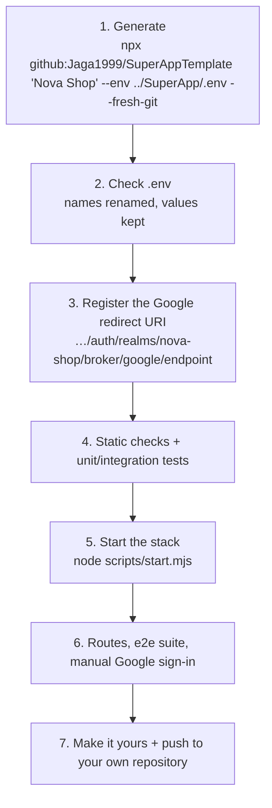

# Project initialization: from template to a running, tested project

A step-by-step runbook for creating a new product from this template, including everything the generator does for you
and everything you still do yourself. Reference for every option: [template.md](template.md).



## 0. Prerequisites

| Tool | Why |
|---|---|
| Node.js 22+ and git | the generator, `npx`, the web projects |
| Docker (6 GB memory for Docker Desktop) | the stack |
| JDK 25 (optional) | backend tests outside Docker |
| Google Chrome | the e2e suite |
| Your template `.env` (optional) | to reuse your Google client and SMTP settings |

Port 8080 (and the debug ports 8081, 8180, 8025, 5432, 5433, 6379, 9090, 9094, 9095) must be free: stop any other
stack first (`node scripts/start.mjs stop` in its folder).

## 1. Generate the project

Run it in the folder that should contain the project (it creates `./nova-shop`):

```bash
cd E:/Projects/Java/Claude
npx github:Jaga1999/SuperAppTemplate "Nova Shop" --env ./SuperApp/.env --fresh-git
```

Other ways, same result:

```bash
# from your local template checkout (its .env is copied automatically)
node scripts/init-project.mjs "Nova Shop" ../nova-shop --fresh-git
# from any git URL or fork
node scripts/init-project.mjs "Nova Shop" ../nova-shop --from https://github.com/Jaga1999/SuperAppTemplate.git --env .env --fresh-git
```

### What the generator does, step by step

| # | Step | Details |
|---|---|---|
| 1 | Reads the arguments | Name `Nova Shop` → `nova-shop` (folder, realm, ids), `NovaShop` (classes, UI), `NOVA_SHOP_*` (env vars), `com.novashop` (Java), `nova_shop` (database) |
| 2 | Gets the template | `npx`/`--from`: shallow `git clone` into a temporary folder (deleted afterwards). Local: uses the checkout itself |
| 3 | Copies it | Everything except `.git`, `node_modules`, build output and test results: sources, docs, images, `.claude/`, `AGENTS.md`, `CLAUDE.md`, and the template's `.env` when it has one |
| 4 | Uses `--env` | Copies the given file over `.env` (before renaming) |
| 5 | Renames contents | Every text file: `com.superapp` → package, `superappX` → `novaShopX`, `SuperApp` → `NovaShop`, `SUPERAPP` → `NOVA_SHOP`, `superapp` → `nova-shop`, database `superapp` → `nova_shop`. `.env` included, so its names match and its values are kept. Binary files are left alone |
| 6 | Renames files and folders | Java package folders (`com/superapp` → `com/novashop`), realm JSON, themes, nginx template, … |
| 7 | Completes `.env` | With a `.env`: adds keys `.env.example` has and `.env` lacks. Without one: creates `.env` from `.env.example`, every `CHANGE_ME` replaced by a random secret (cookie key: 32 bytes), Google off, Mailpit for mail |
| 8 | Removes template-only parts | `scripts/init-project.mjs`, the root `package.json`, the README section between `<!-- template:start -->` and `<!-- template:end -->` |
| 9 | Git | `--fresh-git`: new repository, `backend/gradlew` marked executable, one initial commit, no remote |
| 10 | Prints next steps | Where `.env` came from, and the Google redirect URI to register |

### Where the new `.env` comes from

| Situation | Result |
|---|---|
| `--env <file>` given | That file, renamed (`SUPERAPP_*` → `NOVA_SHOP_*`, realm, database), values kept |
| Local template with a `.env`, no `--env` | The template's `.env`, renamed, values kept |
| No `.env` anywhere (`npx`, `--from`, fresh clone) and no `--env` | Generated from `.env.example`: random secrets, Google off |

`--env` expects a **template** `.env` (with `SUPERAPP_*` names), not one from another generated project. Never commit
`.env`; it is git-ignored in the new project too.

## 2. Check `.env` (without printing secrets)

```bash
cd nova-shop
grep -ci superapp .env                                  # 0: nothing left from the template
grep -o '^KEYCLOAK_REALM=.*\|^APP_DB_NAME=.*\|^NOVA_SHOP_GOOGLE_LOGIN_ENABLED=.*\|^PUBLIC_URL=.*' .env
```

Expected: `KEYCLOAK_REALM=nova-shop`, `APP_DB_NAME=nova_shop`, `NOVA_SHOP_GOOGLE_LOGIN_ENABLED=true` (if your template
`.env` had Google), `PUBLIC_URL=http://localhost:8080`.

To add Google later to a generated `.env`: set `NOVA_SHOP_GOOGLE_LOGIN_ENABLED=true`, `GOOGLE_CLIENT_ID`,
`GOOGLE_CLIENT_SECRET`. If the stack already ran once, apply them with `node scripts/start.mjs reset --yes` (the realm
reads them only at its first import; reset **deletes this project's local data**).

For a real product, replace the secrets copied from the template with new ones: delete `.env`, run
`node scripts/start.mjs` (it generates a fresh one), then add Google and SMTP back.

## 3. Register the Google redirect URI

Each project has its own realm, and the realm name is part of the address Google sends users back to. Add the printed
URI in Google Cloud Console → APIs & Services → Credentials → your OAuth client → **Authorized redirect URIs**:

```text
http://localhost:8080/auth/realms/nova-shop/broker/google/endpoint
```

Without it Google shows **"Access blocked: This app's request is invalid — Error 400: redirect_uri_mismatch"**. One
OAuth client can hold the URIs of all your projects. Details: [template.md](template.md#google-sign-in-in-a-new-project).

## 4. Static checks and tests (before Docker)

```bash
cd backend && ./gradlew test && cd ..                      # 44 tests, Testcontainers (Docker must run)
./backend/gradlew -p keycloak/extensions build              # Keycloak extension tests
npm --prefix frontend ci && npm --prefix frontend run typecheck && npm --prefix frontend run lint && npm --prefix frontend run build
npm --prefix keycloakify ci && npm --prefix keycloakify run typecheck && npm --prefix keycloakify run lint
```

All must pass with zero warnings.

## 5. Start the stack

```bash
node scripts/start.mjs
```

First run 5–10 minutes (image builds). It ends with "Everything is up and healthy" and the URLs. Check:

```bash
node scripts/start.mjs status      # 10 services, all healthy
```

## 6. Verify

### Routes (through nginx, signed out)

```bash
for p in / /legal/terms /legal/privacy /robots.txt /sitemap.xml /manifest.webmanifest /app /api/v1/public/config /api/v1/me /auth/admin/ /swagger-ui.html; do
  printf "%-28s %s\n" "$p" "$(curl -s -o /dev/null -w '%{http_code}' http://localhost:8080$p)"
done
```

| Route | Expected |
|---|---|
| `/`, `/legal/*`, `/robots.txt`, `/sitemap.xml`, `/manifest.webmanifest`, `/app…` | 200 |
| `/api/v1/public/config` | 200, `{"googleLoginEnabled":true}` when Google is on |
| `/api/v1/me`, `/api/v1/account/…`, `/api/v1/admin/…` | 401 |
| `POST` without the XSRF header | 403 |
| `/auth/admin/`, `/auth/realms/master/`, `/swagger-ui.html`, `/actuator/health`, `POST /api/auth/backchannel-logout` | 404 (never public) |
| `/oauth2/authorization/keycloak` | 302 to `/auth/realms/nova-shop/…` |

### End-to-end suite

```bash
npm --prefix frontend run e2e          # 8 tests, ~1.5 min, registers a fresh account
```

### By hand

| Check | Where |
|---|---|
| Sign up, verify the email (Mailpit), accept the terms | <http://localhost:8080>, <http://localhost:8025> |
| **Continue with Google** | landing or sign-in page |
| Passkey, authenticator app, recovery codes | Settings → Security |
| Devices: sign out another browser | Settings → Devices |
| Admin area | sign in as `admin@nova-shop.local` (password `SEED_ADMIN_PASSWORD` in `.env`) → Admin |
| API docs | <http://localhost:8081/swagger-ui.html> |
| Keycloak admin console | <http://localhost:8180/auth> (user `admin`, `KEYCLOAK_BOOTSTRAP_ADMIN_PASSWORD`) |

## 7. Make it yours and publish

1. Product details: description and colors (`frontend/src/lib/site.ts`, both `globals.css`), logo, landing page, legal
   texts ([customization.md](customization.md)).
2. Create an empty repository on GitHub, then:

   ```bash
   git remote add origin https://github.com/<you>/nova-shop.git
   git push -u origin main
   ```

   Several GitHub accounts on one machine: put the account in the URL (`https://<account>@github.com/…`) so Git
   Credential Manager uses the right one.
3. Before production: [deployment.md](deployment.md).

## Starting over

```bash
cd nova-shop && docker compose down -v --rmi local    # containers, data volumes and built images of this project
cd .. && rm -rf nova-shop                              # then generate again
```

Both commands delete data permanently.

## If something fails

| Symptom | Fix |
|---|---|
| `already exists and is not empty` | Pick another destination or remove the old folder (see *Starting over*) |
| `Set "repository" in the template's package.json` | The template's `package.json` still has the `<owner>/<repo>` placeholder; set it, or pass `--from <git-url>` |
| `--env: … is not a file` | Check the path (relative to where you run the command) |
| `npx` asks for GitHub sign-in or can't clone | The repository is private: sign in to git for that account, or use `--from` with an URL you can read |
| Google `redirect_uri_mismatch` | Step 3 |
| Google button missing | `NOVA_SHOP_GOOGLE_LOGIN_ENABLED=true` and the client in `.env`, then reset |
| Port already in use | Another stack runs: `node scripts/start.mjs stop` there |
| An e2e step times out on the first navigation | See [troubleshooting.md](troubleshooting.md#tests); rerun once the stack has settled |

More: [troubleshooting.md](troubleshooting.md).
