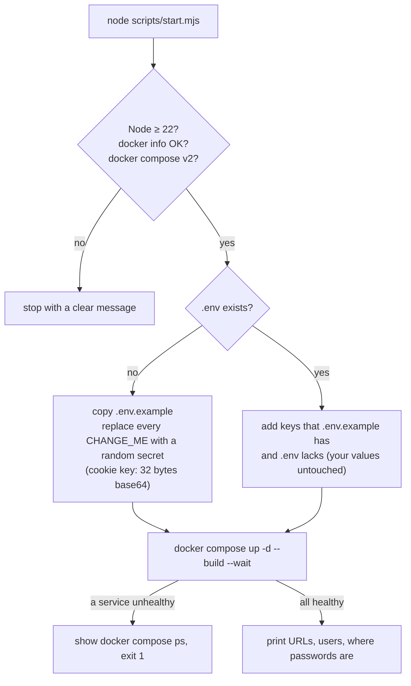

# Scripts

Two Node.js scripts (Node 22+, no dependencies) in `scripts/`.

| Script | Purpose | Kept in generated projects |
|---|---|---|
| `start.mjs` | Run the whole stack locally with one command | yes |
| `init-project.mjs` | Turn the template into a new, renamed project | no (deletes itself) |

## `scripts/start.mjs`: local run

```bash
node scripts/start.mjs [command]
```

| Command | What happens |
|---|---|
| *(none)* or `up` / `start` | Checks prerequisites → prepares `.env` → `docker compose up -d --build --wait` → prints all URLs |
| `status` | `docker compose ps`: every service, its health and ports |
| `logs [service]` | Follows the last 200 lines and new output of all services or one (`backend`, `keycloak`, `frontend`, `nginx`, `postgres`, `keycloak-postgres`, `redis`, `kafka`, `keycloak-kafka`, `mailpit`) |
| `stop` / `down` | `docker compose down`: containers removed, **volumes (data) kept** |
| `reset --yes` | `docker compose down -v` (**deletes all data**: users, databases, Kafka, Redis), then starts again. Without `--yes` it refuses |

### Step by step (`up`)



- Secrets are generated with Node's `crypto.randomBytes` (32 bytes, base64url).
- It never prints a secret; the summary names the `.env` key instead.
- Exit code 0 means every container is healthy.

## `scripts/init-project.mjs`: create a project from the template

Full guide: [template.md](template.md). In short:

```bash
# from your local copy of the template (the template stays untouched)
node scripts/init-project.mjs "Acme Shop" ../acme-shop --fresh-git

# straight from GitHub, nothing cloned by hand
npx github:<you>/SuperApp "Acme Shop" --fresh-git
```

| Option | Meaning |
|---|---|
| `"Acme Shop"` | Project name: letters, digits, spaces, `-`, `_`. Optional when a destination is given (taken from its folder name) |
| `../acme-shop` | Destination folder (must not exist or be empty, outside the template). Without it the current checkout is converted in place |
| `--package com.example.shop` | Java base package (default `com.acmeshop`) |
| `--fresh-git` | Start a new git repository with one initial commit |
| `--from <git-url>` | Clone the template from this URL instead of using the local copy |
| `--dry-run` | Show what would change; touch nothing |

What it renames:

| Template | Becomes (for "Acme Shop") |
|---|---|
| `superapp` | `acme-shop` (realm, clients, themes, Docker images, npm packages, config keys, folder) |
| `superappX` (camelCase) | `acmeShopX` |
| `SuperApp` | `AcmeShop` (classes, product name in UI and emails) |
| `SUPERAPP` | `ACME_SHOP` (environment variables) |
| `com.superapp` | the Java package |
| database `superapp` | `acme_shop` |

How the new project gets its `.env`:

| The template folder… | The new project's `.env` |
|---|---|
| has a `.env` | A copy of it, renamed like every file (`SUPERAPP_*` → `ACME_SHOP_*`), **values kept** (Google client, SMTP…). Keys the template gained since are added |
| has no `.env` (fresh clone, `--from`, `npx github:…`) | Created from `.env.example`: every `CHANGE_ME` replaced by a random secret, optional values left as placeholders (Google off, Mailpit for mail). Add your Google client and SMTP yourself |

It also marks `backend/gradlew` executable in git, removes the
template-only files (`init-project.mjs`, root `package.json`, the README's template section) and prints the Google
redirect URI to register for the new realm.

## Root `package.json`

Only for the generator: it lets `npx github:<owner>/<repo>` find `init-project.mjs`. Set its `repository` to your GitHub
repository after you push the template. Generated projects don't have it.
