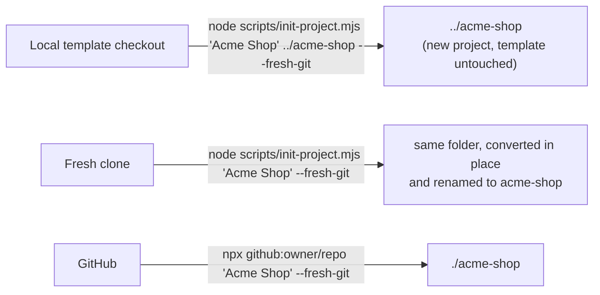

# Using the template

SuperApp is meant to be **copied and renamed**, not forked by hand. `scripts/init-project.mjs` turns it into your own
product in one command: every spelling of the name, the Java packages, the realm, themes, images, database and
environment variables.

## 1. Three ways to start



### A. From your local copy into a new folder (recommended)

```bash
node scripts/init-project.mjs "Acme Shop" ../acme-shop --fresh-git
node scripts/init-project.mjs ../acme-shop --fresh-git        # name taken from the folder: "acme-shop"
```

The template stays untouched, so one checkout can create any number of projects. The copy contains everything except
git history, build output and `node_modules`: sources, docs and images, your `.env` (renamed; missing keys added), and
the agent setup (`AGENTS.md`, `CLAUDE.md`, `.claude/`).

### B. Convert a fresh clone in place

```bash
git clone https://github.com/<owner>/<repo>.git acme && cd acme
node scripts/init-project.mjs "Acme Shop" --fresh-git
```

The folder itself is renamed to `acme-shop` at the end. On Windows, if the folder is open in an editor or a terminal,
the script prints the one command to rename it yourself. It refuses to run twice.

### C. Straight from GitHub

Set `"repository"` in the root `package.json` to your template repository (e.g. `"github:you/SuperApp"`) and push.
Then, anywhere:

```bash
npx github:you/SuperApp "Acme Shop" --fresh-git
npx github:you/SuperApp "Acme Shop" ./code/acme-shop --fresh-git
```

npm fetches only the generator script; it shallow-clones the repository into a temporary folder and creates the
project. Your local `.env` is never on GitHub, so the new project gets a fresh `.env` with generated secrets: add your
Google client and SMTP settings to it. `--from <git-url>` clones any other repository or fork.

## 2. Options

| Option | Meaning |
|---|---|
| `project-name` | `"Acme Shop"`, `acme-shop`, `AcmeShop`: letters, digits, spaces, `-`, `_`. Optional with a destination |
| `destination` | A path (contains `/` or `\`, or starts with `.`). Must not exist or be empty, and lie outside the template |
| `--package com.example.shop` | Java base package (default `com.acmeshop`; Java keywords are rejected) |
| `--from <git-url or path>` | Clone this template instead of using the local checkout |
| `--fresh-git` | Start a new repository with one initial commit (no template history) |
| `--dry-run` | Print what would change; touch nothing |
| `--help` | Usage |

## 3. What gets renamed

| Template | For `"Acme Shop"` | Where |
|---|---|---|
| `superapp` | `acme-shop` | folder, realm, OAuth clients, login and email themes, Docker images, npm packages, Spring config keys, Kafka groups |
| `superappX` (camelCase) | `acmeShopX` | bean methods, email message keys |
| `SuperApp` | `AcmeShop` | classes (`AcmeShopApplication`), product name in the UI and emails |
| `SUPERAPP_*` | `ACME_SHOP_*` | environment variables |
| `com.superapp` | `com.acmeshop` or `--package` | backend and Keycloak extension packages (folders moved too) |
| database `superapp` | `acme_shop` | app database name and user |

Both file contents and file or folder names are renamed. Binary files (images, JARs, the Gradle wrapper) are left
alone. The script also:

- marks `backend/gradlew` executable in git (Windows and npm tarballs drop the bit);
- removes template-only files: itself, the root `package.json`, and the README section between
  `<!-- template:start -->` and `<!-- template:end -->`;
- renames the legal documents' product name;
- prints the Google redirect URI to register for the new realm
  (`http://localhost:8080/auth/realms/acme-shop/broker/google/endpoint`).

## 4. After generating

```bash
cd ../acme-shop
node scripts/start.mjs                      # builds and starts everything
```

1. Review `.env`: for a real product, generate new secrets (delete `.env` and run `start.mjs` again, or replace the
   values). Never reuse the template's secrets across products.
2. Register the printed Google redirect URI on your Google OAuth client, or create a new client (see below).
3. Adapt the product: name, colors, logo, landing page, legal texts ([customization.md](customization.md)).
4. Create the remote repository and push.
5. Run the checks ([testing.md](testing.md)).

### Google sign-in in a new project

**What carries over.** Generating from a local checkout copies your `.env`, including `SUPERAPP_GOOGLE_LOGIN_ENABLED`,
`GOOGLE_CLIENT_ID` and `GOOGLE_CLIENT_SECRET`. The variable names are renamed (`ACME_SHOP_GOOGLE_LOGIN_ENABLED`) and the
values are kept, so the Google button works straight away. When the template has no `.env` (a fresh clone, `--from`,
`npx github:…`), the new `.env` is created from `.env.example` with generated secrets and Google turned off: add the
three values to it yourself before the first start, or afterwards followed by `node scripts/start.mjs reset --yes`
(the realm reads them only at its first import; reset deletes that project's local data).

**What changes: the redirect URI.** Google accepts a sign-in only when it returns to a URI registered on the OAuth
client. That URI contains the **realm name**, and every generated project has its own realm:

| Project | Realm | Redirect URI to register |
|---|---|---|
| SuperApp (template) | `superapp` | `http://localhost:8080/auth/realms/superapp/broker/google/endpoint` |
| Acme Shop | `acme-shop` | `http://localhost:8080/auth/realms/acme-shop/broker/google/endpoint` |
| Nova Shop | `nova-shop` | `http://localhost:8080/auth/realms/nova-shop/broker/google/endpoint` |
| Production | your realm | `https://<your-domain>/auth/realms/<realm>/broker/google/endpoint` |

Until the new URI is registered, Google answers **`Error 400: redirect_uri_mismatch`** ("Access blocked: This app's
request is invalid"). Nothing in the project needs to change. The generator prints the exact URI at the end of its run.

To register it: Google Cloud Console → APIs & Services → Credentials → your OAuth client → **Authorized redirect URIs** →
add the URI → Save. It takes effect within a few minutes.

| Approach | When |
|---|---|
| One shared OAuth client, one redirect URI per project | Local development and experiments (a client can hold many URIs) |
| A separate OAuth client per product | Real products: Google's consent screen shows that client's app name, logo and support email |

## 5. Keeping projects up to date with the template

Generated projects don't track the template (that is what `--fresh-git` means). To bring later template improvements
over, compare the template's history since you generated and apply the relevant commits by hand, or generate a fresh
copy with the same name into a temporary folder and diff it against your project.
