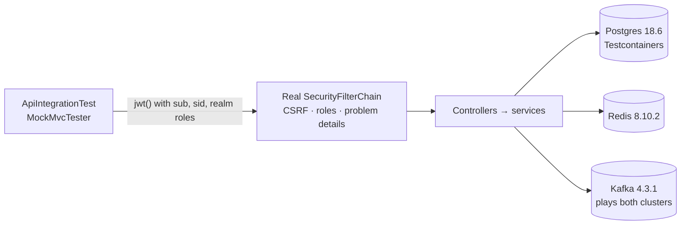

# Backend testing

JUnit 5 + AssertJ everywhere, Mockito for unit tests, Testcontainers for real infrastructure. Overview and the full
scenario list: [testing.md](testing.md).

```bash
cd backend
./gradlew test                                   # everything (Docker must be running)
./gradlew test --tests '*AeadCipherTest'         # one class
./gradlew test --tests '*ApiIntegrationTest.adminListsUsersAndValidatesPaging'   # one method
./gradlew test --rerun                           # ignore Gradle's up-to-date check
```

Windows: `gradlew.bat test`. Report: `backend/build/reports/tests/test/index.html`.

Test JVM settings (`build.gradle.kts`): JUnit Platform, `-Duser.timezone=UTC`, `-XX:+EnableDynamicAgentLoading`
(Mockito's agent without a warning), `-Xshare:off`. The build compiles tests with `-Werror` too.

## 1. Unit tests

Plain classes, no Spring context, milliseconds each. They live next to the code they test, in the feature's
`internal` package.

| Class | What it proves |
|---|---|
| `shared/crypto/AeadCipherTest` | Cookie encryption round-trips; the same input encrypts differently every time (random nonce); a ciphertext is bound to its purpose (an access-token cookie can't be replayed as a refresh-token cookie); tampering and garbage are rejected; short keys are refused |
| `auth/internal/oauth/LoginOptionsTest` | Only same-origin return paths are accepted (no open redirect); only known account actions pass; browser parameters become the right Keycloak parameters; unknown identity providers are ignored |
| `user/internal/UserReconciliationTest` | Nightly repair keeps users Keycloak still has, erases the others, stops at the erasure cap, and touches nothing when Keycloak doesn't answer |

Pattern:

```java
class SlugTest {

    @Test
    void lowercasesAndJoinsWords() {
        assertThat(Slug.of("Hello World")).isEqualTo("hello-world");
    }

    @ParameterizedTest
    @ValueSource(strings = {"", " ", "--"})
    void rejectsEmptyInput(String input) {
        assertThatThrownBy(() -> Slug.of(input)).isInstanceOf(IllegalArgumentException.class);
    }
}
```

## 2. API and integration tests

`ApiIntegrationTest` boots the whole application (`@SpringBootTest`) with the **real** security chain, Flyway on a
real Postgres, real Redis and real Kafka, started once by `TestcontainersConfiguration` with the **same image versions
as `compose.yaml`**. `@ServiceConnection` wires the connection details automatically. Only Keycloak is replaced: a
request is signed in with a test JWT.



| Test | Proves |
|---|---|
| `anonymousCallersGetAProblem401` | No cookie → `401` with `application/problem+json` |
| `signedInUserGetsTheirProfile` | `/api/v1/me` returns the signed-in user |
| `cookieAuthenticatedMutationsWithoutCsrfTokenAreRejected` | Mutations need `X-XSRF-TOKEN` |
| `cachedTokensSurviveTheAppJsonMapper` | Token sets serialize and deserialize with Jackson 3 unchanged |
| `adminEndpointsRequireTheAdminRole` | `user` role → `403` on `/api/v1/admin/**` |
| `adminListsUsersAndValidatesPaging` | Admin list works; `size=500` → `400` |
| `publicConfigIsReachableWithoutASession` | The landing page's config endpoint is public |

Writing one, for a hypothetical `notes` feature you added (see
[development.md](development.md#add-a-backend-feature)):

```java
// import static org.springframework.security.test.web.servlet.request.SecurityMockMvcRequestPostProcessors.csrf;
@Test
void signedInUserCreatesANote() {
    var user = UUID.randomUUID();
    assertThat(mvc.post().uri("/api/v1/notes")
            .with(as(user, "user")).with(csrf())
            .contentType(MediaType.APPLICATION_JSON)
            .content("""
                    {"title": "First"}
                    """))
            .hasStatus(201)
            .bodyJson().extractingPath("$.title").isEqualTo("First");
}
```

- `as(userId, roles…)` builds the JWT (`sub`, `sid`, `realm_access.roles`) and the Spring authorities.
- Use a fresh `UUID` per test: the database is shared by all tests in the run.
- Assert problem responses with `.hasStatus(400).hasContentType(MediaType.APPLICATION_PROBLEM_JSON)`.
- Calls to Keycloak's Admin API go to `http://keycloak.invalid`: a test that needs them should stub the client bean
  (`@MockitoBean`) rather than reach a real Keycloak.

## 3. Architecture test

`ArchitectureTest` (ArchUnit) keeps the feature packages honest without a framework:

1. A feature's `internal` package is private to that feature (`auth`, `identity`, `user`, `admin`).
2. `shared` never depends on a feature.
3. Features form no dependency cycles.
4. Controllers live in `internal` packages.

When it fails, it names the class and the forbidden dependency. Fix the design (move the type to the feature's public
package, or publish an event), don't loosen the rule.

## 4. What is deliberately not unit-tested

| Area | Covered by |
|---|---|
| The OAuth dance with Keycloak, silent refresh, back-channel logout | e2e suite against the real Keycloak |
| nginx routing and limits | e2e suite + manual `curl` checks ([testing.md](testing.md#api-and-security-rules)) |
| Kafka consumer of Keycloak events | e2e registration (the user appears) + reconciliation unit test |

## 5. Keycloak extension tests

```bash
./backend/gradlew -p keycloak/extensions build
```

`LegalConsentTest`: a new user must accept; a user who accepted the current versions is never asked again; changing
either document asks again; front matter is parsed; a missing `version` fails loudly; and the real files in
`keycloak/legal/` are valid. The Keycloak image build runs these tests too, so a broken legal file never ships.

## 6. Troubleshooting

| Symptom | Cause |
|---|---|
| Every integration test fails at once with `Could not find a valid Docker environment` | Docker isn't running |
| First run is slow | Testcontainers pulls Postgres, Redis and Kafka images once |
| `HV000151` on startup | A Bean Validation constraint was put on a controller method that overrides an `*ApiDocs` interface; constraints belong on the interface |
| Compiler warning fails the build | `-Werror`: fix the warning (unchecked cast, deprecation…), don't suppress it broadly |
