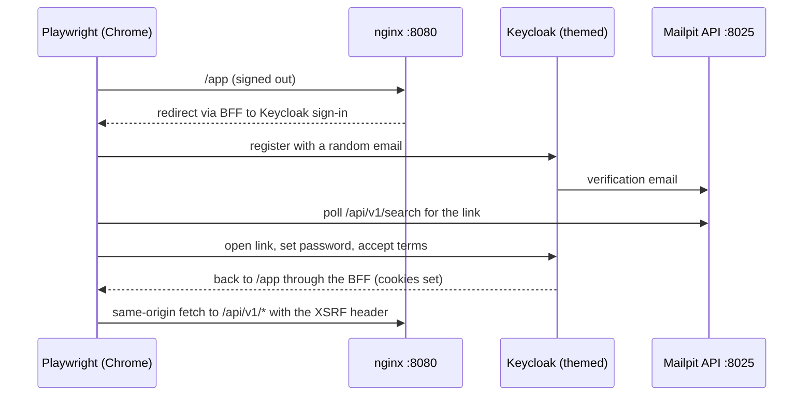

# Frontend testing

Two projects, the same tools: TypeScript and Biome for static checks; Playwright for the end-to-end suite that lives in
`frontend/e2e` and also covers the Keycloak theme (it is what users see while signing in). Overview and the full
scenario list: [testing.md](testing.md).

## 1. Static checks

| Command | `frontend/` | `keycloakify/` |
|---|---|---|
| `npm run typecheck` | `next typegen` (typed routes) → `tsc` for the app → `tsc` for `e2e/` | `tsc -b` (app + Vite config) |
| `npm run lint` | `biome check`: lint rules, import order, formatting | same |
| `npm run lint -- --write` | applies safe fixes | same |
| `npm run build` | production build; fails on type errors | Vite build + Keycloakify JAR (needs Maven; the Docker build does it for you) |

TypeScript runs in `strict` mode; Biome's config is in each project's `biome.jsonc`
and reads the root `.gitignore`.

## 2. End-to-end tests

```bash
node scripts/start.mjs                    # stack running and healthy
npm --prefix frontend run e2e             # headless, Google Chrome
npm --prefix frontend run e2e:headed      # watch the browser
npm --prefix frontend run e2e:report      # HTML report; failures keep a trace (timeline, DOM, network)
npx --prefix frontend playwright test -c frontend/e2e -g "passkey"     # only matching tests
```

### How it works



- **No stored credentials.** `newIdentity()` creates `e2e-<random>@superapp.local` with a policy-compliant random
  password, in memory.
- **Real emails.** `linkFromEmail()` polls Mailpit's API for the newest message to that address and extracts the action
  link.
- **Real API calls.** `api(page, method, path)` runs `fetch` inside the page, exactly like the app: cookies plus the
  `X-XSRF-TOKEN` echo.
- **Keycloak page detection.** `kcPage(page)` reads `window.kcContext.pageId`, so tests wait for the right themed page
  (`login.ftl`, `register.ftl`, `legal-consent.ftl`…) instead of guessing from the URL.
- **Passkeys.** A Chrome DevTools virtual authenticator (`WebAuthn.addVirtualAuthenticator`) stands in for Touch ID /
  Windows Hello / a security key.
- **Serial.** The tests share one account (`test.describe.serial`), one worker, no retries: a flaky step fails loudly.

### The suite (`e2e/tests/auth-and-api.spec.ts`)

| Test | Checks |
|---|---|
| register, verify email, set password, accept terms | Register page, consent page shown once, email link, password, lands in the app greeting the user by name |
| legal consent is not asked again | Second sign-in goes straight to the app |
| the legal documents are public pages… | `/legal/terms` and `/legal/privacy` show the same versions the consent page showed |
| every API works for a signed-in user | `/api/v1/me`, public config, sessions, sign-in methods, sign out |
| wrong password is rejected… | Generic error message, no account enumeration |
| forgot password | Email link, new password, sign in with it |
| passkey: register one, then sign in with it | WebAuthn registration and passwordless sign-in |
| passkey cancelled | The user sees a short, actionable message |

The API test expects `googleLoginEnabled: true`, matching the template's `.env`. With Google sign-in off, change that
expectation.

### Configuration (`e2e/playwright.config.ts`)

| Setting | Value |
|---|---|
| `baseURL` | `E2E_BASE_URL` or `http://localhost:8080` |
| Mailpit | `E2E_MAILPIT_URL` or `http://127.0.0.1:8025` |
| Browser | installed Google Chrome (`channel: 'chrome'`), no download |
| Timeouts | 60 s per test, 10 s per assertion |
| On failure | screenshot + trace kept |

### Writing a test

```ts
test('the devices page lists this browser', async ({ page }) => {
  await signIn(page, user.email, user.password)
  await expectInApp(page)
  await page.goto('/app/settings/sessions')
  await expect(page.getByText('This device')).toBeVisible()
})
```

Prefer role and label locators (`getByRole`, `getByLabel`) over CSS; on Keycloak pages the form field ids
(`#username`, `#password`) are stable because the theme keeps Keycloak's field names.

## 3. Documentation screenshots

```bash
npm --prefix frontend run docs:screenshots
```

A separate Playwright suite (`e2e/screenshots/`, config `e2e/playwright.screenshots.config.ts`) that overwrites
`docs/images/*.png`:

1. Public pages: landing (light, dark, full page, phone), legal page.
2. Sign-in and sign-up through the BFF (real Keycloak).
3. Signed-in app: home (light, dark, phone), profile, security, devices.
4. Admin area: grants the fresh user `admin` with `kcadm.sh` inside the Keycloak container, then overview and a user.
5. Theme pages that are hard to reach in a script (OTP, recovery codes, error…) from the theme preview on :5174 with
   mock data (the config starts that dev server itself).
6. Swagger UI and Mailpit.

With another Compose project name or realm: `COMPOSE_PROJECT_NAME=… DOCS_REALM=… npm run docs:screenshots`.

## 4. Manual checks worth doing

| What | How |
|---|---|
| Phone layout | DevTools device toolbar, 375 × 812; no horizontal scroll |
| Dark mode | Theme toggle → Dark; sign-in pages stay light by design |
| CSP | DevTools console has no `Content-Security-Policy` errors |
| Accessibility | Tab through each page; Lighthouse accessibility ≥ 95 |
| Performance | Lighthouse on the landing page (production build on :8080) |
| Theme pages | `npm --prefix keycloakify run dev`, open `?kc=<page>.ftl` for each page you changed |
