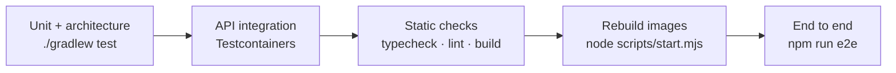

# Testing

Five levels, from fast and narrow to slow and complete. Nothing is mocked at the top: the e2e suite drives the real
stack exactly like a user.

| Level | Tooling | Where | Needs | Time | Details |
|---|---|---|---|---|---|
| Unit | JUnit 5, AssertJ, Mockito | `backend/src/test/java/com/superapp/**/internal` | JDK 25 | seconds | [testing-backend.md](testing-backend.md) |
| Architecture | ArchUnit | `ArchitectureTest` | JDK 25 | seconds | [testing-backend.md](testing-backend.md#3-architecture-test) |
| API / integration | `@SpringBootTest`, `MockMvcTester`, Testcontainers | `ApiIntegrationTest` | Docker | ~1 min | [testing-backend.md](testing-backend.md#2-api-and-integration-tests) |
| Keycloak extension | JUnit 5 | `keycloak/extensions/src/test` | JDK 25 or Docker | seconds | [testing-backend.md](testing-backend.md#5-keycloak-extension-tests) |
| Static checks | TypeScript, Biome | `frontend/`, `keycloakify/` | Node 22+ | seconds | [testing-frontend.md](testing-frontend.md#1-static-checks) |
| End to end | Playwright + installed Google Chrome | `frontend/e2e/tests` | running stack | 1–2 min | [testing-frontend.md](testing-frontend.md#2-end-to-end-tests) |



## Run everything

```bash
cd backend && ./gradlew test && cd ..
./backend/gradlew -p keycloak/extensions build
npm --prefix frontend run typecheck && npm --prefix frontend run lint && npm --prefix frontend run build
npm --prefix keycloakify run typecheck && npm --prefix keycloakify run lint
node scripts/start.mjs
npm --prefix frontend run e2e
```

## Before you call a change done

| Touched | Run |
|---|---|
| `backend/` | `./gradlew test` (zero warnings, `-Werror`) |
| `frontend/` | `typecheck`, `lint`, `build` |
| `keycloakify/` | `typecheck`, `lint` |
| `keycloak/extensions/` | `./backend/gradlew -p keycloak/extensions build` |
| anything a user sees, any auth flow | rebuild the image(s), then `npm --prefix frontend run e2e` |

## Test scenarios

Every behaviour that matters, and what proves it. **A** = automated (where), **M** = check by hand (how).

### Registration and sign-in

| # | Scenario | Expected | Proof |
|---|---|---|---|
| 1 | Sign up with a new email | Consent page → verification email → set password → lands in `/app` | A: e2e *register, verify email…* |
| 2 | Sign in with the right password | Lands in `/app`, cookies `__Host-sa_at`, `__Host-sa_rt` set, `HttpOnly`, `Secure`, `SameSite=Lax` | A: e2e; M: DevTools → Application → Cookies |
| 3 | Wrong password | Generic error, no hint whether the account exists | A: e2e *wrong password…* |
| 4 | Unknown email | Same generic error as 3 | M |
| 5 | Five wrong passwords | Account temporarily locked (brute-force protection) | M |
| 6 | Weak password (short, no digit…) | Rejected by the realm policy with a clear message | M |
| 7 | Forgot password | Email link → new password → sign in | A: e2e *forgot password* |
| 8 | Passkey registration and sign-in | Works with a platform or virtual authenticator | A: e2e *passkey…* |
| 9 | Passkey dialog cancelled | Short message, user can retry | A: e2e *passkey cancelled* |
| 10 | Google sign-in (when enabled) | Account picker, then `/app`; first time: consent page | M (needs a real Google client) |
| 11 | Terms version raised | Every user is asked again on the next sign-in | A: `LegalConsentTest`; M: change `version`, rebuild `keycloak` |
| 12 | Same versions | Never asked again | A: e2e *legal consent is not asked again* |

### Session, tokens, revocation

| # | Scenario | Expected | Proof |
|---|---|---|---|
| 13 | Access token expires (5 min) | Next API call refreshes silently; the user notices nothing | M: wait 5 min, click around; network tab shows only 200s |
| 14 | Several tabs refresh at once | One refresh at Keycloak (single flight in Redis) | M: open 3 tabs after expiry; Keycloak events show one `REFRESH_TOKEN` |
| 15 | Sign out | Cookies cleared, Keycloak session ended, back button doesn't show data | M |
| 16 | End one device from *Devices* | That browser is signed out within one request | M: two browsers; end one; refresh it |
| 17 | Admin: *sign out everywhere* | All the user's sessions end immediately | M: admin area → user → sign out everywhere |
| 18 | Password changed | Other sessions revoked | M |
| 19 | User disabled or deleted in Keycloak | Next request is 401; app user erased (delete) | M; A: `UserReconciliationTest` for the nightly repair |
| 20 | Tampered or foreign cookie | Ignored (decryption fails), treated as signed out | A: `AeadCipherTest` |

### API and security rules

| # | Scenario | Expected | Proof |
|---|---|---|---|
| 21 | Call the API without cookies | `401` problem JSON | A: `anonymousCallersGetAProblem401` |
| 22 | `POST`/`PATCH`/`DELETE` without `X-XSRF-TOKEN` | `403` | A: `cookieAuthenticatedMutationsWithoutCsrfTokenAreRejected` |
| 23 | Non-admin calls `/api/v1/admin/**` | `403` | A: `adminEndpointsRequireTheAdminRole` |
| 24 | Admin lists users with bad paging (`size=500`) | `400` problem JSON | A: `adminListsUsersAndValidatesPaging` |
| 25 | `returnTo=https://evil.example` on sign-in | Ignored, goes to `/app` (no open redirect) | A: `LoginOptionsTest.rejectsOpenRedirects` |
| 26 | Unknown `action` on sign-in | Rejected | A: `LoginOptionsTest.rejectsUnknownActions` |
| 27 | Keycloak admin path through `/auth/admin/…` | `404` (not on the proxy allow-list) | M: `curl -i http://localhost:8080/auth/admin/` |
| 28 | Back-channel logout from outside | Blocked by nginx | M: `curl -i -X POST http://localhost:8080/api/auth/backchannel-logout` |
| 29 | Flood a path | `429` from nginx | M: `for i in $(seq 100); do curl -s -o /dev/null -w "%{http_code}\n" http://localhost:8080/oauth2/authorization/keycloak; done` |
| 30 | Public config | Reachable without a session | A: `publicConfigIsReachableWithoutASession` |

### Pages and UI

| # | Scenario | Expected | Proof |
|---|---|---|---|
| 31 | Open `/app` signed out | Sent to sign-in, then back to `/app` | M |
| 32 | Non-admin opens `/app/admin` | Not shown (and API says 403) | M |
| 33 | Legal pages | Public, same versions as Keycloak asks for | A: e2e *legal documents…* |
| 34 | Light, dark, system theme | All pages readable; sign-in pages always light | M; screenshots suite |
| 35 | Phone width (375 px) | No horizontal scroll, compact menus | M: DevTools device mode; screenshots suite |
| 36 | 1080p and 2K | Content fills the width sensibly | M |
| 37 | CSP | No console CSP errors; every inline script has the nonce | M: DevTools console |
| 38 | SEO files | `/robots.txt`, `/sitemap.xml`, `/manifest.webmanifest`, `/opengraph-image` respond | M: `curl` |

### Data and events

| # | Scenario | Expected | Proof |
|---|---|---|---|
| 39 | New Keycloak user | Row in `app_user` within seconds (Kafka) | M: `docker compose exec postgres psql … -c "select * from app_user"` |
| 40 | Profile changed in Keycloak | App row updated | M |
| 41 | Broken event | Ends in the `.DLT` topic, consumer keeps going | M |
| 42 | Events lost while the BFF was down | Nightly reconciliation repairs it (capped erasures) | A: `UserReconciliationTest` |
| 43 | Schema migration | Flyway applies it on start, fails fast on a checksum mismatch | A: every integration test run |

## Documentation screenshots

`npm --prefix frontend run docs:screenshots` regenerates `docs/images`. See
[testing-frontend.md](testing-frontend.md#3-documentation-screenshots).
